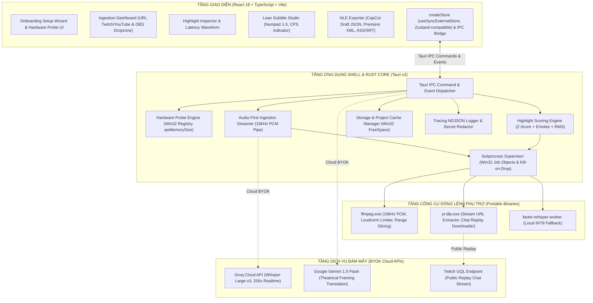

# NeuroClip — AI Subtitle Studio

<div align="center">

<!--

-->

**Desktop App chuyên biệt hóa cho Clipper & cộng đồng Swarm VN**  
*Đề xuất Highlight tiềm năng đa phương thức, STT, hỗ trợ vietsub cá thể hóa, cho phép xuất sang CapCut PC Draft, Adobe Premiere Pro & Aegisub...*

[](LICENSE)
[-0078D6?style=flat-square&logo=windows)](https://microsoft.com/windows)
[](https://v2.tauri.app/)
[](https://www.rust-lang.org/)
[](https://react.dev/)
[](https://www.typescriptlang.org/)
[](https://tailwindcss.com/)
[](src/test/)
[-orange?style=flat-square)](#-current-implementation)

[Overview](#-tổng-quan-dự-án) •
[Current Implementation](#-current-implementation) •
[Milestone Roadmap](#️-lộ-trình-phát-triển-v1-milestone-roadmap) •
[Architecture](#️-architecture--tech-stack) •
[Install & Run](#-yêu-cầu-môi-trường--setup) •
[Folder Structure](#-folder-structure) •
[Contribution](#-contributing--governance) •
[License](#-license)

</div>

---

## 📖 Tổng quan dự án

**Neuro-sama** là AI VTuber tiên phong toàn cầu do Vedal phát triển. Cùng với **Evil Neuro**, Neuro-sama tạo nên một hiện tượng văn hóa livestream độc nhất vô nhị với sự đồng hành của cộng đồng "The Swarm".

Hiện tại quy trình clip hoàn toàn thủ công, có thể tốn nhiều giờ cho một vài clip ngắn. Một VOD có thể dài 4-8 giờ, việc lọc và trích xuất tự động moments tiềm năng giúp giảm thời gian tìm lại và crop cũng như có thể tìm được thêm những moments mới.

**NeuroClip** được phát triển như một **Windows Desktop Application siêu nhẹ** bán tự động hỗ trợ clip:
- **Audio-First Ingestion**: Trích xuất luồng âm thanh AAC trực tiếp từ VOD trực tuyến, tiết kiệm $\ge 98.5\%$ thời gian chờ, băng thông mạng, và dung lượng.
- **Multimodal Highlight Scoring**: Tính toán tương quan giữa chat Twitch (Z-Score hiệu chỉnh), tỷ lệ Emote, và Audio RMS bù độ trễ livestream 4.5 giây.
- **Hybrid AI Speech-to-Text**: Kết hợp Cloud Groq Whisper Large-v3 (200x) và Local Faster-Whisper INT8 ngoại tuyến với bộ lọc Silero VAD.
- **Theatrical Framing Vietsub**: Hỗ trợ dịch thuật LLM tích hợp Neuroverse Lore độc quyền và ma trận đại từ, nội suy bypass filter (optional).
- **Native NLE Timeline Export**: Export project folder **CapCut PC Draft JSON**, **Adobe Premiere Pro XML (FCP7 `<xmeml version="4">`)**. Dual Export Safeguard: luôn tự động sinh file phụ đề `.ass` (chuẩn màu char) + `.srt`.

---

## ⚡ Current Implementation

Dự án hiện đang ở **Phase 4: Implementation & Verification** theo mô hình Single Source of Truth (SSOT). Tiến độ hiện tại đạt:

```text
[█████████████████████████░░░░░░░] 25 / 33 Tasks Hoàn thành (75.8% v1 Core)
667 Vitest Tests Passing (36 files) • 135 Node Native Runner Tests Passing (52 suites) • 409 Rust Tests Passing (25 active binaries) • Zero Unhandled Panics
```

Toàn bộ 25 tasks thuộc 6 Milestones đầu tiên (`M4.1`–`M4.6`) và 2/3 tasks của Milestone `M4.7` (`TASK-M4-24`, `TASK-M4-25`) đã hoàn thành và vượt qua toàn bộ cổng kiểm định tự động (cùng đợt Stabilization `P0`–`P2`):

- **Desktop Shell & Neuro Design (`TASK-M4-01`)**:
  - Chạy native trên Windows 10/11 qua Tauri v2 (WebView2) với mức chiếm dụng RAM tĩnh $\le 90\text{MB}$.
  - Giao diện Dark Theme theo bảng màu chuẩn **PO Option 1** (`#12131C`, `#1A1C28`, Neuro `#FFB6C1`, Evil `#FF0055`, Vedal `#98FB98`, Guest `#FFD700`, Chat `#87CEEB`), hỗ trợ hiệu ứng Acrylic/Mica và fallback về màu đặc an toàn; `main.tsx` bọc `<GlobalErrorBoundary><App /></GlobalErrorBoundary>` và `App.tsx` cung cấp shell 4 tab tối giản (`overview`, `ingestion` gắn `IngestionDashboard` + `DropZone`, `highlights` gắn `HighlightViewer`, `studio` gắn `SubtitleStudio`).
- **Xử lý lỗi hợp nhất & Giao thức IPC (`TASK-M4-02`)**:
  - Enum `AppError` (`thiserror` tại `error/{mod.rs, codes.rs}`) chuẩn hóa **48 mã lỗi định danh** (`ERR_*`, đồng bộ 48/48 với `src/services/ipc/error.ts`), thực thi chính sách zero-panic tĩnh trên Rust backend.
  - Tự động đóng gói `IpcErrorResponse` cho TypeScript kèm giải thích tiếng Việt và phân loại lỗi có thể phục hồi; React `GlobalErrorBoundary` và `ErrorBanner` hiển thị thông báo thân thiện và nút thử lại (Retry).
- **Bộ điều phối & Giám sát tiến trình con (`TASK-M4-03`)**:
  - `SubprocessSupervisor` (`src-tauri/src/sidecar/{mod.rs, supervisor.rs, kill_switch.rs}`, `src/services/ipc/sidecar.ts`) thực thi bất đồng bộ `ffmpeg.exe` / `yt-dlp.exe` với bounded 1,000-line channel, tách dòng `\n`/`\r` và phát event `sidecar:progress`.
  - Phòng thủ **Kill-on-Drop** & **Windows Job Objects** (`windows_sys::Win32::System::JobObjects`, `JOB_OBJECT_LIMIT_KILL_ON_JOB_CLOSE`) thu hồi 100% tiến trình con trong $\le 300\text{ms}$ (0 zombie processes). *(Ghi chú: phần backend sớm `config/hardware.rs` & `config/app_config.rs` từ commit cũ `0abf3fc` thuộc `TASK-M4-27` / `TASK-M4-28`.)*
- **Ghi log cấu trúc & Che giấu thông tin nhạy cảm (`TASK-M4-04`)**:
  - Structured NDJSON logging bất đồng bộ bằng `tracing` (`src-tauri/src/logging/{mod.rs, rotation.rs, secrets.rs}`, re-export qua `core::logging`, `commands/log_cmd.rs`), tự động xoay vòng file hàng ngày (`neuroclip-YYYY-MM-DD.log`), lưu tối đa 14 ngày và giới hạn thư mục log $\le 50\text{MB}$.
  - Bộ lọc bảo mật 2 lớp tự động che giấu (`[REDACTED]`) các API Key (Groq `gsk_*`, Gemini `AIza*`, OpenAI `sk-*`) và Twitch OAuth Token trước khi ghi đĩa hoặc gửi qua IPC; UI Log Viewer (`useLogStore`) có hàng đợi FIFO và ring-buffer 1,000 dòng.
- **Kiểm tra dung lượng đĩa & Bộ nhớ đệm dự án (`TASK-M4-05`)**:
  - Gọi Win32 kernel `GetDiskFreeSpaceExW` trực tiếp ($\le 1\text{ms}$); chặn tác vụ tải và trả về mã `ERR_INGEST_DISK_FULL` khi ổ đĩa còn dưới 5GB trống để bảo vệ hệ điều hành.
  - Quản lý không gian làm việc dự án cách ly tại `%LOCALAPPDATA%/NeuroClip/`, chuẩn hóa `validate_vod_id` / `resolve_vod_project_dir` chống path traversal và tự động dọn dẹp cache `.tmp`/`.wav` an toàn mà không ảnh hưởng tệp dự án cốt lõi (`.json`, `.ass`, `.srt`, `.mp4`).
- **Pipeline Audio-First Ingestion (`TASK-M4-06`)**:
  - Thu nạp luồng âm thanh trực tiếp từ URL Twitch/YouTube VOD bằng `yt-dlp` (lưu kèm `video_stream_url`) và transcode sang 16kHz mono PCM qua FFmpeg stdout pipe, tiết kiệm $\ge 98.5\%$ dung lượng mạng và ổ đĩa (VOD 8h 30GB video chỉ tiêu tốn ~400MB audio).
  - Áp dụng hàng đợi `BoundedAudioQueue` giới hạn RAM $\le 1\text{MB}$, hỗ trợ nạp cookie trình duyệt và xoay vòng User-Agent chống bot YouTube; màn hình `IngestionDashboard` theo dõi tiến độ tải thời gian thực.
- **Bộ nhập khẩu video cục bộ & Giao thức `asset://` (`TASK-M4-07`)**:
  - Hỗ trợ kéo thả video nội bộ (`.mp4`, `.mkv`, `.webm`, `.mov`, `.ts`, `.flv` qua `DropZone.tsx` & `local_importer.rs`, lệnh `import_local_video`), trích xuất âm thanh PCM 16kHz mono cục bộ với 0 byte truyền ra Internet.
  - Đăng ký giao thức tùy chỉnh bất đồng bộ `asset://` (`src-tauri/src/core/custom_protocol.rs`) hỗ trợ HTTP `206 Partial Content` Range requests (chunk tối đa `2 MiB`) và chặn tuyệt đối path traversal / UNC / drive-relative.
- **Bóc tách & Chuẩn hóa Chat Replay (`TASK-M4-08`)**:
  - Thu nạp lịch sử chat từ Twitch GQL (phân trang cursor, `twitch_gql.rs`) và YouTube Live Chat (`youtube_chat.rs`, `chat_cmd.rs`).
  - Chuẩn hóa toàn bộ tin nhắn theo Schema 5.3 `ChatEventsContainer` (`chat_parser.rs`) với từ điển Swarm emotes, hỗ trợ trích xuất streaming 2 lượt NDJSON đệm 64KB giữ heap delta $< 4\text{MB}$ khi xử lý 500,000 tin nhắn.
  - Thuật toán Chat Heatmap cửa sổ trượt tích hợp bộ lọc spam bot ($\le 3$ tin/tác giả) và cơ chế soft fallback (ERR-05, `chat:fallback`) sang Audio RMS khi chat bị tắt hoặc lỗi. *(Ghi chú: `stt/whisper_sidecar.rs` và `stt/subtitle_export.rs` từ commit cũ `e372200` là phần companion local STT / early backend `TASK-M4-24` đã được sửa lỗi BGR & đồng bộ bảng màu **PO Option 1**: Neuro `#FFB6C1`, Evil `#FF0055`, Vedal `#98FB98`, Guest `#FFD700`, Chat `#87CEEB`, Unknown `#FFFFFF`.)*
- **Thuật toán Chat Velocity Z-Score hiệu chỉnh (`TASK-M4-09`)**:
  - Gom cụm thời gian cố định 5s ($W = 5.0\text{s}$), cơ chế trần chống spam bot $\le 3$ tin nhắn/tác giả/5s, tự động đệm liên tục toàn bộ VOD.
  - Ngưỡng sàn tin nhắn $X(t) < 15 \implies Z_{\text{adj}} = 0.0$ triệt tiêu false positives trong các đoạn stream yên ắng; Z-score hiệu chỉnh với hằng số làm mịn $\epsilon = 0.5$ và cửa sổ trượt nền 60s $O(N)$ bằng Cumulative Prefix Sums số nguyên `u64`/`u128`.
- **Động cơ trọng số Emote đặc thù văn hóa Neuro Swarm (`TASK-M4-10`)**:
  - Bảng tra cứu FNV-1a zero-allocation với đệm stack `[u8; 64]` cho hơn 40 biểu cảm đặc thù (`Tutel`, `SOOP`, `Erm`, `Heart` / `<3`, `KEKW`, `LUL`, `💀`...), phân loại thành 3 nhóm văn hóa (`Humor`, `Surprise`, `SwarmLore`).
  - Tokenizer phân ranh giới từ và dấu câu thông minh, tính tỷ lệ mật độ $E_{\text{ratio}}(t) \in [0.0, 1.0]$ theo khung 5s khớp 1:1 với chat velocity, trích xuất top 5 emotes mỗi bucket với tốc độ quét $\ge 900.000$ tokens/s.
- **Bộ quét đỉnh năng lượng âm thanh streaming (`TASK-M4-11`)**:
  - Tính toán RMS nguyên bản từ mẫu PCM 16-bit phân tích khối 500ms (8.000 samples @ 16kHz mono), kẹp sàn im lặng $-96.0\text{dBFS} \implies \text{RMS} = 0.0$ và chuẩn hóa theo biên độ sóng sin 1kHz.
  - Baseline trượt 30s với $O(N)$ prefix sums; cơ chế nhận diện đỉnh kép (vọt $\ge 18\text{dB}$ so với nền hoặc $\ge 2.5\sigma$) kèm silence gating chống kích hoạt giả; xử lý streaming file audio 8 tiếng chỉ trong 2.76s với RAM đỉnh 3.96MB.
- **Hợp nhất đa phương thức & Bộ bù độ trễ livestream 4.5s (`TASK-M4-12`)**:
  - Công thức tính điểm hợp nhất đa kênh: $\text{Score} = (0.60 \cdot Z_{\text{norm}} + 0.25 \cdot E_{\text{ratio}} + 0.15 \cdot \text{RMS}_{\text{norm}}) \times 100.0$ (tự động fallback $1.0 \cdot \text{RMS}_{\text{norm}}$ khi không có chat).
  - Bù trễ CDN livestream $4.5\text{s}$ kết hợp Pre-roll Buffer $10.0\text{s} \implies$ clip luôn bắt đầu trước đỉnh chat $\ge 14.5\text{s}$; thuật toán phân cụm khoảng cách 30s và khử trùng lặp NMS $\le 50\%$.
  - Cơ chế Dynamic Padding ở cuối VOD tự động co giãn Post-roll và bù vào Pre-roll bảo đảm clip luôn đạt $\ge 15.0\text{s}$ và $t_{\text{end}} \le$ `duration_seconds` 100%, xuất `highlight_clusters.json` Schema 5.4 và giao diện `HighlightViewer.tsx`.
- **Bộ tải phân đoạn video chính xác không tải thừa (`TASK-M4-13`)**:
  - FFmpeg input-seeking HTTP Range Request trực tiếp qua mạng từ `video_stream_url` trong `vod_manifest.json` (`-ss <start> -to <end>` đặt trước `-i`, kèm lazy `yt-dlp -g` fallback & retry URL hết hạn), cắt phân đoạn 90s trong $\le 10\text{s}$ với dung lượng chỉ 30MB–80MB (tiết kiệm $\ge 99\%$ băng thông mạng và dung lượng đĩa so với tải 30GB video).
  - Stream copy `-c copy` và `-avoid_negative_ts make_zero` đảm bảo không bị gián đoạn/đóng băng khung hình đầu tiên; tự động kiểm tra Keyframe alignment và audio/video drift $\le 50\text{ms}$; quản lý tiến trình an toàn qua Windows Job Object.
- **Bộ tiền xử lý âm thanh & Lọc khoảng lặng Pure Rust `tract-onnx` Silero VAD (`TASK-M4-14`)**:
  - Chuẩn hóa âm thanh qua FFmpeg EBU R128 `loudnorm=I=-16:TP=-1.5:LRA=11` (16kHz mono PCM) kèm soft-knee limiter + 4x Hermite cubic oversampling True Peak (`ERR-08 Screaming Defense`) giữ đỉnh $\le -1.5\text{dBFS}$ không vỡ tiếng.
  - Suy luận nơ-ron **Silero VAD v5 đồ thị tĩnh 16kHz (`silero_vad_16k.onnx`, 1.28MB)** chạy thuần Rust qua `tract-onnx v0.21` (`ADR-008`) xử lý 60s audio trong `0.3817s` (bản release), loại bỏ 100% nhạc chiptune/tông đơn âm và $\ge 95\%$ nhạc nền BGM đa âm (`AC-14.2`), cắt bỏ khoảng lặng $> 1.5\text{s}$ và chia nhỏ chunk $< 20\text{MB}$ tại điểm nghỉ tự nhiên (`AC-14.3` qua `vad_bridge.rs`).
  - Tích hợp tầng dự phòng tự động Pure Rust DSP (`compute_frame_speech_prob_fallback`) khi model gặp lỗi nạp/I/O, thực thi bất đồng bộ qua `tokio::task::spawn_blocking`.
- **Máy khách Groq Whisper Cloud API (`TASK-M4-15`)**:
  - Tích hợp HTTP client `groq_client.rs` & command `transcribe_highlight_clip` (`stt_cmd.rs`) gọi `whisper-large-v3` kèm word-level timestamps, tự động chia chunk $< 20\text{MB}$ (tránh lỗi `HTTP 413`), Karaoke Mode (`condition_on_previous_text=false`), và Exponential Backoff (`1s, 2s, 4s`) cho `HTTP 429`.
  - Phát tiến độ chunk thật qua `stt:progress` camelCase (`{ taskId, stage, percent, etaSec?, currentChunk, totalChunks }`) và `stt:chunk`, nối đồng bộ vào `src/services/ipc/stt.ts` và `src/stores/useTranscriptStore.ts`.
- **Worker xử lý ngoại tuyến Faster-Whisper INT8 & Quản lý mô hình (`TASK-M4-16`)**:
  - Triển khai `faster_whisper_worker.rs`, `model_manager.rs` (kiểm tra SHA-256 streaming và từ chối file 0-byte) cùng `whisper_sidecar.rs` (Q5_K GGUF) và IPC command `start_faster_whisper_transcription`.
  - Tích hợp **VRAM Hardware Guardrail** (`GuardrailPolicy`: `auto_downgrade` | `strict_reject`, ngưỡng `< 2500MB` VRAM) tránh CUDA OOM trên GPU 4GB VRAM.
- **Máy khách Google Gemini 1.5 Flash & Theatrical Framing (`TASK-M4-17`)**:
  - Triển khai `gemini_client.rs`, `prompt_builder.rs` và `commands/translation_cmd.rs` (`translate_vietsub`, `test_gemini_connection`, `update_speaker_role`) với **Theatrical Framing System Prompt** (`PRD.md` §6.3), `safetySettings: BLOCK_NONE`, phân khối 25–35 dòng kèm Sliding Context Window.
  - Áp dụng **Defensive Safety Fallback (`ERR-07`)** bảo lưu câu tiếng Anh gốc + `is_flagged_for_review: true` khi gặp bộ lọc an toàn, truyền `speaker_id` qua `merge_translations()`, map HTTP `403` về `TranslationError::InvalidApiKey`, và nối đồng bộ vào `useTranscriptStore.ts`.
- **Từ điển Neuro Lore, Ma trận đại từ & Tự động gán vai (`TASK-M4-18`)**:
  - Tích hợp trọn vẹn 12 thuật ngữ văn hóa cộng đồng The Swarm (`PRD.md §6.2`: `heart`, `tutel`, `gymbag`, `filter_leaking`, `swarm`, `abandoned`, `dinking`, `erm`, `cooked`, `unhinged`, `kekw`, `aware_clueless`), cơ chế Unicode `.to_lowercase()` chặn đứng các bản dịch thô cấm dịch (`detect_forbidden_translations`).
  - Ma trận đại từ xưng hô 6 vai chuẩn (`vedal`, `neuro`, `evil`, `guest`, `chat`, `unknown`) theo `PRD §6.1` & `ADR-006`, bảng màu chuẩn **PO Option 1** (Hex và ASS BGR), phím tắt nhanh 1–5, hồ sơ collab khách mời (`Anny`, `Camila`, `Filian`) và 2 phong cách dịch (`TikTok Gen Z Trend` vs `Formal Subber`).
  - Động cơ Hybrid Diarization 3 tầng (LLM ngữ cảnh -> chuẩn hóa tất định -> heuristic fallback) đạt độ chính xác $\ge 85\%$ (thực nghiệm đạt $91.76\%$ trên stress benchmark), tích hợp đồng bộ vào `prompt_builder.rs`, `gemini_client.rs` và `TranslateVietsubOptions`.
- **Ngắt dòng thông minh tiếng Việt & Tối ưu tốc độ đọc CPS (`TASK-M4-19`)**:
  - Động cơ ngắt dòng bảo toàn từ ghép tiếng Việt thuần Rust (`line_wrapper.rs`) với từ điển 180+ thuật ngữ văn hóa Swarm và từ ghép thông dụng, giới hạn $\le 42$ ký tự/dòng (16:9) và $\le 26$ ký tự/dòng (9:16), tối đa 2 dòng, cơ chế chunking an toàn cho chuỗi ký tự dài không dấu cách.
  - Bộ tối ưu tốc độ đọc CPS (`cps_optimizer.rs`): tính CPS chuẩn xác, cảnh báo 3 mức (Xanh $< 17$, Vàng $17..=20$, Đỏ $> 20$), thuật toán Time Borrowing mượn khoảng lặng phía sau tối đa $800\text{ms}$ hạ CPS về $\le 17.0$ với vùng đệm an toàn $\ge 50\text{ms}$ (bảo đảm 0 va chạm timeline 100%), tuân thủ Schema 5.5.
  - Tích hợp trực tiếp vào luồng dịch Gemini (`gemini_client.rs`), bảo vệ tiền tố lỗi fallback (`[Dịch lỗi: ...]`), phơi bày Tauri IPC commands (`wrap_vietnamese_subtitles`, `optimize_transcript_cps`), đồng bộ utility frontend `text_wrap.ts` đạt exact string parity 100% giữa TypeScript và Rust.
- **Màn hình Subtitle Studio & Video Canvas đồng bộ timeline (`TASK-M4-20`)**:
  - Giao diện biên tập phụ đề 2 cột tích hợp trình phát video HTML5 nạp từ custom protocol `asset://` (`toLocalAssetUrl`), phát video $60\text{ FPS}$ mượt mà.
  - Hỗ trợ 2 Vertical Presets 9:16 (`Center-Crop` & `Two-stack Top-Bottom 50/50` kèm vạch ngăn cố định `preset2-divider`) chuyển đổi tức thì ($\le 2.46\text{ms}$, SLA $\le 50\text{ms}$) mà không cần reload thẻ `<video>`.
  - Đồng bộ hai chiều video $\leftrightarrow$ phụ đề với độ trễ $\le 9.24\text{ms}$ (SLA $\le 30\text{ms}$), thanh tua timeline Scrubber điều tiết bằng `requestAnimationFrame` đạt $\ge 55\text{ FPS}$ khi tua liên tục (`useStudioStore.ts`, `SubtitleStudio.tsx`, `VideoCanvas.tsx`, `TimelineScrubber.tsx`).
- **Danh sách phụ đề ảo hóa & Biên tập trực tiếp (`TASK-M4-21`)**:
  - Tích hợp ảo hóa danh sách hiệu năng cao (`useVirtualizer`), render giới hạn 15–20 DOM rows trên viewport ngay cả với 1.000 dòng phụ đề ($\le 25$ DOM elements đồng thời, SLA 60 FPS).
  - Tự động cuộn theo video playback mượt mà kèm cơ chế tạm dừng 3s khi người dùng cuộn thủ công; ô nhập liệu textarea tự co giãn với độ trễ phản hồi $< 2\text{ms}$ (SLA $< 16\text{ms}$); vi điều chỉnh timecode In/Out từng $\pm 100\text{ms}$ (`VirtualizedSegmentList.tsx`, `SegmentRow.tsx`, `TimecodeNudge.tsx`).
- **Bàn phím số 1-chạm đổi phong cách nhân vật & Thanh công cụ đa chọn (`TASK-M4-22`)**:
  - Phím tắt bàn phím số `1`–`5` và `Numpad1`–`Numpad5` đổi vai và style màu nhân vật tức thì theo bảng màu **PO Option 1** (Vedal `#98FB98`, Neuro `#FFB6C1`, Evil `#FF0055`, Guest `#FFD700`, Chat `#87CEEB`).
  - Cơ chế Input Guarding thông minh chặn đứng sự kiện phím khi đang nhập liệu trong `<textarea>`, `<input>` hoặc bộ gõ IME; hỗ trợ `Shift+Click` (chọn dải dòng) và `Ctrl/Cmd+Click` (toggle từng dòng) cùng batch update 1.000 dòng chỉ trong $0.051\text{ms}$ (SLA $\le 50\text{ms}$) (`CharacterHotkeyBar.tsx`, `useStudioHotkeys.ts`).
- **Đèn cảnh báo tốc độ đọc trực quan & Trợ lý nới rộng thời gian thủ công (`TASK-M4-23`)**:
  - Tính toán chỉ số CPS theo thời gian thực chuẩn Unicode UTF-8 (`Array.from(text.trim()).length`), phân loại 3 mức đèn cảnh báo trực quan: Xanh ($< 17\text{ CPS}$), Vàng ($17..=20\text{ CPS}$), Đỏ nhấp nháy ($> 20\text{ CPS}$).
  - Trợ lý 1-chạm *"Nới thời gian (Borrow Silence)"* (kèm phím tắt `Shift + E`) tự động mượn khoảng lặng liền kề tối đa $800\text{ms}$ để hạ CPS về mức an toàn, bảo toàn khoảng đệm an toàn $\ge 50\text{ms}$ chống đè timeline 100% (`cps.ts`, `CPSIndicator.tsx`, action `borrowSilence`).
- **Bộ xuất phụ đề chuẩn màu `.ASS` & `.SRT` (`TASK-M4-24`)**:
  - Chuẩn hóa phân hệ `src-tauri/src/export/{mod.rs, ass_exporter.rs, srt_exporter.rs}` (duy trì `stt/subtitle_export.rs` làm facade tương thích ngược), `commands/export_cmd.rs`, `services/ipc/export.ts` và `types/export.ts`.
  - Ghi file `.ass` và `.srt` chuẩn **UTF-8 with BOM** (`write_file_with_bom`), tự động phân giải `PlayResX`/`PlayResY` theo `target_layout` (`1920x1080` hoặc `1080x1920`), áp dụng bảng màu **PO Option 1** (`Vedal` `#98FB98` `Outline = 2.5px`, `Chat` `Bold = 0, Outline = 2.0px`, `Neuro`/`Evil`/`Guest` `Bold = -1, Outline = 3.0px`).
- **Bộ sinh thư mục dự án CapCut PC Draft JSON & Dual Export Safeguard (`TASK-M4-25`)**:
  - Triển khai `capcut_draft.rs` và `capcut_schema.rs` sinh thư mục dự án CapCut Windows (`draft_content.json`, `draft_meta_info.json`) với video/audio/subtitle track theo đúng `target_layout`, đồng thời luôn sao lưu song song `subtitle.ass` và `subtitle.srt` vào cùng thư mục.
  - Hoàn thiện `ExportModal.tsx` nối trực tiếp với `SubtitleStudio.tsx` và `useStudioStore` (truyền đúng `target_layout` và raw OS `video_file_path`).

---

## 🗺️ Lộ trình phát triển (v1 Milestone Roadmap)

Toàn bộ 33 tasks của v1 (32 baseline + 1 task tích hợp `TASK-M4-29B`) được tổ chức thành 9 Milestones tuần tự. Quá trình phát triển tuân thủ luồng dữ liệu đầu-cuối:

```mermaid
flowchart LR
    subgraph M41 ["M4.1: Foundation"]
        F1["Shell & IPC"]
        F2["Config & Logs"]
    end

    subgraph M42 ["M4.2: Ingestion & Chat"]
        I1["Audio-First Stream"]
        I2["Chat Replay Parser"]
    end

    subgraph M43 ["M4.3: Highlights"]
        H1["Z-Score & Emotes"]
        H2["Audio RMS & Slicing"]
    end

    subgraph M44 ["M4.4: STT & VAD"]
        S1["Silero VAD"]
        S2["Groq & Faster-Whisper"]
    end

    subgraph M45 ["M4.5: Vietsub & Lore"]
        L1["Theatrical Framing"]
        L2["Swarm Lore & Diarization"]
        L3["Smart Wrap & CPS"]
    end

    subgraph M46 ["M4.6: Subtitle Studio"]
        U1["Timeline Player"]
        U2["Numpad Styling & CPS"]
    end

    subgraph M47 ["M4.7: NLE Export"]
        E1["CapCut PC Draft"]
        E2["Premiere XML & ASS"]
    end

    subgraph M48 ["M4.8: Integration"]
        G1["Onboarding Wizard"]
        G2["DPAPI Key Vault"]
        G3["App Pipeline Wiring"]
    end

    subgraph M49 ["M4.9: Packaging"]
        P1["E2E Benchmark"]
        P2["NSIS/MSI Installer"]
    end

    M41 --> M42 --> M43 --> M44 --> M45 --> M46 --> M47 --> M48 --> M49
```



### 🚀 Bảng tiến độ Milestone & Hạng mục bàn giao (Deliverables Matrix)

| Cột mốc | Phân hệ / Mục tiêu | Key Deliverables | Tasks | Trạng thái |
|:---|:---|:---|:---:|:---:|
| **M4.1** | **Nền tảng cốt lõi (Foundation)** | Tauri v2 Acrylic Shell (`TASK-M4-01`), Giao thức 48 mã lỗi IPC (`TASK-M4-02`), Subprocess Supervisor & Kill-Switch (`TASK-M4-03`), Tracing NDJSON & Secret Redaction (`TASK-M4-04`) | **4 / 4** | <kbd>ĐÃ HOÀN THÀNH</kbd> |
| **M4.2** | **Thu nạp VOD, Local Import & Chat** | Pre-flight disk check 5GB (`TASK-M4-05`), Audio-First 16kHz PCM streamer (`TASK-M4-06`), Local Video Importer + `asset://` Range 206 (`TASK-M4-07`), Chat Replay GQL/YouTube & heatmap (`TASK-M4-08`) | **4 / 4** | <kbd>ĐÃ HOÀN THÀNH</kbd> |
| **M4.3** | **Động cơ Highlight đa phương thức** | Thuật toán Chat Velocity Z-Score, Bộ lọc Emote Swarm, Quét đỉnh âm thanh RMS, Bù trễ stream 4.5s, Lossless range slicer | **5 / 5** | <kbd>ĐÃ HOÀN THÀNH</kbd> |
| **M4.4** | **Bóc băng giọng nói & Tách thoại** | Silero VAD (`tract-onnx` 16kHz + DSP fallback) & FFmpeg loudnorm (`TASK-M4-14` ✅), Groq Whisper Large-v3 client `<20MB` chunks (`TASK-M4-15` ✅), Faster-Whisper INT8 worker & model manager (`TASK-M4-16` ✅) | **3 / 3** | <kbd>ĐÃ HOÀN THÀNH</kbd> |
| **M4.5** | **Bản địa hóa & Vietsub Swarm Lore** | Gemini 1.5 Flash Theatrical Framing & `BLOCK_NONE` (`TASK-M4-17` ✅), Từ điển 12 thuật ngữ Swarm Lore & Hybrid Diarization (`TASK-M4-18` ✅), Smart line-breaker & CPS (`TASK-M4-19` ✅) | **3 / 3** | <kbd>ĐÃ HOÀN THÀNH</kbd> |
| **M4.6** | **Trình biên tập Subtitle Studio UI** | Canvas video sync timeline (`TASK-M4-20` ✅), Virtualized subtitle list 60fps (`TASK-M4-21` ✅), Bàn phím số 1-chạm đổi màu nhân vật (`TASK-M4-22` ✅), Đèn cảnh báo CPS (`TASK-M4-23` ✅) | **4 / 4** | <kbd>ĐÃ HOÀN THÀNH</kbd> |
| **M4.7** | **Xuất bản NLE đa nền tảng** | Xuất Aegisub .ASS (chuẩn màu style), .SRT (`M4-24` ✅), CapCut PC Draft JSON & Dual Export (`M4-25` ✅), Adobe Premiere Pro XML FCP7 `<xmeml version="4">` & `export:progress` (`M4-26` ⏳) | **2 / 3** | 🔄 *In Progress (M4-24 ✅, M4-25 ✅; M4-26 Pending)* |
| **M4.8** | **Tích hợp hệ thống & Bảo mật** | Hardware probe recommendation UI, First-run setup wizard, Windows DPAPI Credential Locker, Sidecar auto-updater, App Pipeline Wiring (`HighlightViewer` → `Slicer` → `useStudioStore`, `M4-29B`) | **0 / 4** | ⏳ *Planned* |
| **M4.9** | **Kiểm thử E2E & Đóng gói bộ cài** | E2E synthetic pipeline test harness, Low-end PC stress benchmark (<100MB RAM), Bộ cài đặt Windows NSIS / MSI chính thức | **0 / 3** | ⏳ *Planned* |
| **TỔNG** | **Toàn bộ 9 Milestones thuộc v1 MVP** | **Cam kết zero-panic backend, zero-any frontend, coverage 100% contracts** | **25 / 33** | **75.8% Complete** |

> 💡 **Single Source of Truth:** Chi tiết đặc tả kỹ thuật, tiêu chí nghiệm thu định lượng (AC) và QA checklist của toàn bộ 33 tasks (`TASK-M4-01` đến `TASK-M4-32` + `TASK-M4-29B`) được theo dõi tập trung tại [`docs/TASK_BOARD.md`](docs/TASK_BOARD.md).

---

## 🏗️ Architecture & Tech Stack

Hệ thống được tổ chức thành 4 phân tầng độc lập theo tài liệu kiến trúc chuẩn `docs/ARCHITECTURE.md`:



### Tech Stack:

| Thành phần | Công nghệ / Thư viện | Vai trò & Mục đích sử dụng |
|:---|:---|:---|
| **Desktop Shell** | [Tauri v2](https://v2.tauri.app/) (`@tauri-apps/api`, `@tauri-apps/plugin-opener`) | Shell native WebView2 siêu nhẹ, bảo toàn RAM tĩnh $\le 90\text{MB}$. |
| **Backend Core** | [Rust](https://www.rust-lang.org/) (Edition 2021, Target `stable-x86_64-pc-windows-msvc`) | Logic xử lý I/O tốc độ cao, quản lý bộ nhớ an toàn tuyệt đối. |
| **Async Runtime** | [Tokio v1.38](https://tokio.rs/) (`features = ["full"]`), `tokio-util` | Xử lý bất đồng bộ, stream stdout/stderr tiến trình qua bounded channels. |
| **Windows APIs** | `windows-sys` v0.52 (Win32_Storage_FileSystem, Win32_System_JobObjects, Win32_Security...) | Truy vấn dung lượng đĩa `GetDiskFreeSpaceExW`, diệt tiến trình con triệt để bằng Job Objects. |
| **Data Serialization** | `serde` v1.0, `serde_json` v1.0 | Tuần tự hóa JSON Schemas (5.1 đến 5.6) giao tiếp qua IPC. |
| **Backend Logging** | `tracing` v0.1, `tracing-subscriber` v0.3, `tracing-appender` v0.2 | Structured NDJSON logging, xoay vòng hàng ngày và bảo vệ dung lượng đĩa $\le 50\text{MB}$. |
| **Error Handling** | `thiserror` v1.0 | Định nghĩa cây lỗi phân cấp `AppError` và chuẩn hóa **48 mã lỗi canonical** (parity 48/48 với TS `error.ts`). |
| **Frontend Framework** | [React 18.3](https://react.dev/), [TypeScript 5.6](https://www.typescriptlang.org/) (Strict Mode) | Giao diện người dùng SPA hiện đại, kiểm tra kiểu nghiêm ngặt (Zero-any). |
| **UI & Styling** | [Tailwind CSS 3.4](https://tailwindcss.com/), `clsx`, `tailwind-merge`, [Lucide Icons](https://lucide.dev/) | Hệ thống thiết kế Dark Theme Neuro-sama chuẩn **PO Option 1** (`#FFB6C1`, `#FF0055`, `#98FB98`, `#FFD700`, `#87CEEB`) với Acrylic/Mica backdrop. |
| **State Management** | `src/stores/createStore.ts` (`React.useSyncExternalStore`, API tương thích [Zustand](https://github.com/pmndrs/zustand)) | Quản lý 8 stores nhẹ (kèm `useStudioStore`), memoized selector, chống race condition. |
| **Build & Tooling** | [Vite 4.3](https://vitejs.dev/), PostCSS, Autoprefixer, ESLint 9, Prettier + `prettier-plugin-tailwindcss` | Đóng gói giao diện tốc độ cao, linter tuân thủ Flat Config. |
| **Pure Rust Neural VAD** | `tract-onnx` v0.21 + `silero_vad_16k.onnx` | Suy luận Silero VAD đồ thị tĩnh 16kHz thuần Rust (không cần DLL C++), kèm DSP fallback an toàn (`ADR-008`). |
| **Testing Harness** | [Vitest 2.1](https://vitest.dev/), `@testing-library/react`, Node.js native test runner (`--test`), `cargo test` | **1,211 bài kiểm tra tự động** (**667 Vitest** [36 files] + **135 Node** [52 suites] + **409 Cargo Rust tests** [25 active binaries: 1 lib + 24 integration]). |
| **Portable Sidecars** | `ffmpeg.exe` (v6.0+), `yt-dlp.exe` (latest), `faster-whisper-worker`, `whisper.cpp` (`main.exe`) | Trích xuất âm thanh trực tuyến, xử lý mẫu PCM 16kHz, cào chat replay Twitch/YouTube, bóc băng giọng nói local INT8 / Q5_K. |

### Data Contracts & JSON Schemas (SSOT):
Mọi dữ liệu trao đổi giữa Rust Backend và TypeScript Frontend đều tuân thủ các schema tĩnh quy định tại Mục 5 `docs/ARCHITECTURE.md`:
- **`hardware_profile.json` (§5.1)**: Thông số CPU, RAM, GPU VRAM và chế độ đề xuất (`cloud_byok`, `hybrid`, `offline_local`).
- **`vod_manifest.json` (§5.2)**: Metadata video VOD, loại nguồn (`twitch_vod`, `youtube_vod`, `local_file`), đường dẫn file audio AAC/PCM và thời lượng.
- **`chat_events.json` (§5.3)**: Danh sách sự kiện chat Twitch chuẩn hóa mốc giây `timestamp_sec`, tác giả, nội dung và danh sách Emote Swarm.
- **`highlight_clusters.json` (§5.4)**: Danh sách các cụm highlight xếp hạng theo điểm số (Score 0–100), Z-score, Audio RMS và lý do nổi bật.
- **`transcript_segments.json` (§5.5)**: Lời thoại bóc băng kèm mốc thời gian In/Out, người nói (`vedal`, `neuro`, `evil`, `guest`, `chat`, `unknown`), văn bản tiếng Anh và Vietsub.
- **`subtitle_project.json` (§5.6)**: Toàn bộ cấu hình dự án phụ đề, layout hiển thị (16:9, 9:16 Center-Crop, 9:16 Two-Stack) và style bảng màu nhân vật **PO Option 1**.

---

## 💻 Yêu cầu môi trường & Setup

### 1. Yêu cầu hệ thống (Prerequisites)
- **Hệ điều hành**: Windows 10 (bản 2004 trở lên) hoặc Windows 11 (64-bit).
- **Node.js**: Phiên bản `v20.x` hoặc `v22.x` (LTS khuyến nghị) kèm `npm >= 10.x`.
- **Rust Toolchain**: `rustc >= 1.78.0` và `cargo` (kênh stable, target `x86_64-pc-windows-msvc`).
- **Visual Studio Build Tools**: C++ build tools (MSVC v142/v143) và Windows 10/11 SDK.
- **WebView2 Runtime**: Đã tích hợp sẵn trên Windows 11 và Windows 10 bản mới.
- **Sidecar Binaries (Công cụ phụ trợ)**:
  - `ffmpeg.exe` và `yt-dlp.exe` (được định vị qua biến môi trường `NEUROCLIP_*_PATH`, `AppConfig.sidecar_paths`, thư mục `%APPDATA%/NeuroClip/bin/` hoặc `%LOCALAPPDATA%/NeuroClip/bin/` [cùng `%LOCALAPPDATA%/NeuroClip/sidecars/<tool>/` cho local STT workers], thư mục đóng gói `resources/sidecars/`, hoặc `PATH` hệ thống; `tauri.conf.json` không dùng `externalBin` / `src-tauri/bin/`).

### 2. Cài đặt các gói phụ thuộc (Dependencies)
Mở PowerShell hoặc terminal tại thư mục gốc của dự án:

```powershell
npm install
```

### 3. Chạy môi trường phát triển (Development)
Khởi chạy đồng thời Vite dev server và Tauri desktop app:

```powershell
npm run tauri dev
```

Nếu chỉ muốn phát triển và kiểm thử riêng giao diện web trên trình duyệt:

```powershell
npm run dev
```
*(Truy cập tại: `http://localhost:1420`)*

### 4. Kiểm thử tự động & Đảm bảo chất lượng (Quality Assurance)
Dự án áp dụng quy chuẩn kiểm thử nghiêm ngặt, bao gồm cả các kịch bản tấn công dồn dập (Adversarial Stress Testing):

```powershell
# Chạy bộ test hợp đồng & AST bằng Node.js Native Test Runner (135 tests, 52 suites)
npm test

# Chạy toàn bộ 667 bài kiểm thử bằng Vitest (36 files: Unit, Component, Adversarial)
npm run test:vitest   # hoặc: npm run test:run

# Chạy toàn bộ 409 bài kiểm thử Rust backend song song (25 active binaries: 1 lib + 24 integration)
cargo test --manifest-path src-tauri/Cargo.toml --all-targets

# Kiểm tra kiểu dữ liệu TypeScript nghiêm ngặt (Zero-any Invariant) & build Vite
npm run typecheck
npm run build

# Quét lỗi cú pháp, linter & kiểm tra định dạng Frontend + Rust
npm run lint
npm run format:check
cargo clippy --manifest-path src-tauri/Cargo.toml --all-targets --all-features -- -D warnings
cargo fmt --manifest-path src-tauri/Cargo.toml --all -- --check
```

### 5. Đóng gói bản cài đặt Production (Build Release)
```powershell
# Biên dịch giao diện frontend sang thư mục dist/
npm run build

# Biên dịch mã nguồn Rust và đóng gói bộ cài đặt Windows (.exe / .msi)
npm run tauri build
```
File cài đặt sau khi đóng gói sẽ nằm tại: `src-tauri/target/release/bundle/nsis/` hoặc `msi/`.

---

## 📁 Folder Structure

```text
neuroclip/
├── .agents/                    # Bộ quy chuẩn và skills dành cho Multi-Agent Team
│   └── skills/                 # Skills hỗ trợ lập trình, tài liệu và frontend design
├── docs/                       # TÀI LIỆU SSOT (Single Source of Truth)
│   ├── adr/                    # 8 Architectural Decision Records (ADR-001 -> ADR-008) & RFC-001..002
│   ├── ARCHITECTURE.md         # Đặc tả kiến trúc hệ thống, data contracts, failure modes
│   ├── CONVENTIONS.md          # Tiêu chuẩn code Rust/TypeScript, clippy lint, IPC protocol
│   ├── PRD.md                  # Tài liệu yêu cầu sản phẩm, chân dung người dùng, epics
│   └── TASK_BOARD.md           # Bảng theo dõi tiến độ chi tiết 33 tasks và 9 milestones
├── scripts/                    # Scripts tự động hóa hỗ trợ phát triển (icon generator...)
├── src/                        # FRONTEND TYPESCRIPT & REACT SPA
│   ├── components/             # React UI Components
│   │   ├── common/             # GlobalErrorBoundary, ErrorBoundary, ErrorBanner
│   │   ├── dashboard/          # IngestionDashboard, DropZone (local video)
│   │   ├── export/             # ExportModal (CapCut Draft, .ASS, .SRT)
│   │   ├── highlight/          # HighlightViewer, index.ts
│   │   └── studio/             # SubtitleStudio, VideoCanvas, TimelineScrubber, VirtualizedSegmentList, SegmentRow, TimecodeNudge, CharacterHotkeyBar, CPSIndicator
│   ├── hooks/                  # Custom React Hooks (useStudioHotkeys: Numpad 1-5, IME isolation)
│   ├── services/               # Tầng dịch vụ kết nối và gọi IPC
│   │   ├── config/             # Hardware probing client, App settings client
│   │   ├── ipc/                # error.ts (48/48), export, sidecar, storage, ingestion, chat, highlight, slice, stt, translation
│   │   └── logging/            # Client logging service, Token redactor, Logger store bridge
│   ├── stores/                 # createStore.ts (useSyncExternalStore, Zustand-compatible) + 8 stores (useStudioStore...)
│   ├── styles/                 # Theme tokens (PO Option 1), globals.css, theme.css, theme.ts
│   ├── types/                  # TypeScript Data Contracts (chat, export, highlight, range_slicer, transcript, translation)
│   ├── utils/                  # text_wrap.ts (line wrap & CPS), cps.ts (Unicode CPS calculation & time borrowing assistant)
│   ├── test/                   # Test Suites (Vitest 667 tests, Node runner 135 tests, typecheck.node.ts)
│   ├── App.tsx                 # Acrylic shell + 4-tab minimal workspace (overview / ingestion / highlights / studio)
│   └── main.tsx                # Root mount bọc <GlobalErrorBoundary>
├── src-tauri/                  # BACKEND RUST CORE (TAURI V2 NATIVE)
│   ├── capabilities/           # Tauri v2 capability permissions (`default.json`)
│   ├── icons/                  # Bộ biểu tượng ứng dụng đa kích thước cho Windows
│   ├── resources/              # Tài nguyên tĩnh nhúng kèm ứng dụng (`models/silero_vad_16k.onnx`)
│   ├── src/                    # Mã nguồn Rust
│   │   ├── commands/           # 42 Tauri IPC Commands (`chat_cmd`, `config_cmd`, `export_cmd`, `highlight_cmd`, `ingest_cmd`, `log_cmd`, `slice_cmd`, `storage_cmd`, `stt_cmd`, `translation_cmd`)
│   │   ├── config/             # Early M4-27/28 backend (`app_config.rs`, `atomic.rs`, `hardware.rs`)
│   │   ├── core/               # `storage.rs` (Win32 FreeSpace, `validate_vod_id`), `custom_protocol.rs` (`asset://` Range 206)
│   │   ├── error/              # Cây lỗi phân cấp `AppError` (`mod.rs`) và 48 mã lỗi `ERR_*` (`codes.rs`)
│   │   ├── export/             # `mod.rs` (Schema 5.6), `ass_exporter.rs`, `srt_exporter.rs`, `capcut_draft.rs`, `capcut_schema.rs`
│   │   ├── highlight/          # `bucket.rs`, `zscore.rs`, `emote_filter.rs`, `swarm_dict.rs`, `audio_rms.rs`, `energy_analyzer.rs`, `fusion.rs`, `cluster.rs`
│   │   ├── ingestion/          # `streamer.rs`, `cookies.rs`, `buffer.rs`, `validator.rs`, `local_importer.rs`, `range_slicer.rs`, `chat_parser.rs`, `twitch_gql.rs`, `youtube_chat.rs`
│   │   ├── logging/            # Hạ tầng Tracing NDJSON (`mod.rs`), xoay vòng log (`rotation.rs`), lọc secret redaction (`secrets.rs`)
│   │   ├── sidecar/            # `supervisor.rs` (bounded 1k lines, `sidecar:progress`) & `kill_switch.rs` (Windows Job Objects)
│   │   ├── stt/                # `audio_prep.rs`, `vad.rs` (`tract-onnx` Silero VAD + DSP fallback), `vad_bridge.rs`, `groq_client.rs`, `faster_whisper_worker.rs`, `whisper_sidecar.rs`, `model_manager.rs`, `transcript_parser.rs`, `subtitle_export.rs` (facade trỏ về `crate::export`)
│   │   ├── translation/        # `gemini_client.rs`, `prompt_builder.rs` (`Theatrical Framing`), `lore_dictionary.rs` (12 Swarm terms), `pronoun_matrix.rs` (PO Option 1), `diarization.rs` (Hybrid 3-stage), `line_wrapper.rs`, `cps_optimizer.rs` (Time Borrowing)
│   │   ├── lib.rs              # Clippy denies/pedantic, đăng ký `asset://` & 42 IPC handlers
│   │   └── main.rs             # Điểm vào thực thi ứng dụng Windows desktop
│   ├── tests/                  # 24 Integration & adversarial test suites + `fixtures/silero_test.wav`
│   ├── build.rs                # Tauri build script
│   ├── Cargo.toml              # Khai báo crate dependencies, target Windows Win32 APIs
│   ├── rustfmt.toml            # Quy chuẩn format code Rust (stable toolchain)
│   └── tauri.conf.json         # Cấu hình cửa sổ, định dạng Acrylic/Mica, bundle metadata
├── AGENTS.md                   # Hiến pháp vận hành Multi-Agent & Nguyên tắc Zero-Guesswork
├── LICENSE                     # Bản quyền mã nguồn mở GNU AGPLv3
├── package.json                # Khai báo dependencies npm và các script thực thi
├── tailwind.config.js          # Khai báo theme tokens và bảng màu Neuro-sama cho Tailwind
├── tsconfig.json               # Cấu hình TypeScript Strict Mode mức tối đa
└── vite.config.ts              # Cấu hình đóng gói Vite cho Tauri v2
```

---

## 🤝 Contributing & Governance

1. **Single Source of Truth (SSOT)**:
   - Kiến trúc hệ thống: [`docs/ARCHITECTURE.md`](docs/ARCHITECTURE.md)
   - Tiêu chuẩn lập trình & Error Protocol: [`docs/CONVENTIONS.md`](docs/CONVENTIONS.md)
   - Đặc tả yêu cầu & Phạm vi sản phẩm: [`docs/PRD.md`](docs/PRD.md)
   - Tiến độ thực tế & QA Checklist: [`docs/TASK_BOARD.md`](docs/TASK_BOARD.md)
2. **Quy chuẩn Code Quality**:
   - Rust: Không có bất kỳ dòng lệnh `.unwrap()`, `.expect()` hay unhandled panic nào trong luồng sản phẩm (`clippy::all`, `clippy::pedantic`).
   - TypeScript: Khóa chặt `strict: true` và `noImplicitAny: true`, 0 xuất hiện của kiểu dữ liệu `any`.
   - Bảo mật: 100% các chuỗi API Key và Auth Token phải được lọc qua bộ khử trùng `redact_secret` trước khi lưu vết.

### Nếu bạn đóng góp với sự hỗ trợ của AI Agents
NeuroClip hiện đang duy trì **Multi-Agent Operating Constitution** quy định tại [`AGENTS.md`](AGENTS.md), chúng tôi khuyến khích sử dụng chế độ Multi-Agent (hay Teamwork) để hỗ trợ phát triển, bổ sung pipeline dành cho Agent đơn thông thường sẽ được cập nhật sau. Nếu bạn sử dụng Agent đơn, hãy tùy chỉnh pipeline theo cách mà bạn tự thấy làm việc hiệu quả và chính xác nhất, nhưng bắt buộc phải nạp đầy đủ `docs/`. Đối với Agents, hãy lưu ý tuân thủ thêm:

3. **Zero-Guesswork Policy**: Tuyệt đối không suy đoán khi gặp các ngã rẽ kiến trúc hoặc quyết định công nghệ. Mọi giải pháp phân vân đều phải lập RFC trong `docs/adr/` và chờ phản hồi chính thức từ Product Owner.
4. (Multi-Agent) **Quy tắc Gate Checks**: Mã nguồn chỉ được triển khai khi đã vượt qua các cổng phê duyệt kiểm định nghiêm ngặt từ `@lead-architect`, `@tech-lead` và `@qa-reviewer`.


Bạn muốn đóng góp tính năng mới hoặc báo cáo lỗi? Vui lòng đối chiếu kỹ [`docs/CONVENTIONS.md`](docs/CONVENTIONS.md) trước khi gửi Pull Request.

---

## 📜 License

Dự án này được phát hành dưới giấy phép mã nguồn mở **GNU Affero General Public License v3.0 (AGPL-3.0)**.  
Xem toàn văn giấy phép tại [`LICENSE`](LICENSE).

```text
NeuroClip — AI Subtitle Studio
Copyright (C) 2026 Nashidiwa

This program is free software: you can redistribute it and/or modify
it under the terms of the GNU Affero General Public License as published by
the Free Software Foundation, either version 3 of the License, or
(at your option) any later version.
```

---

<div align="center">

🐢 Heart Heart Heart ✨

</div>
