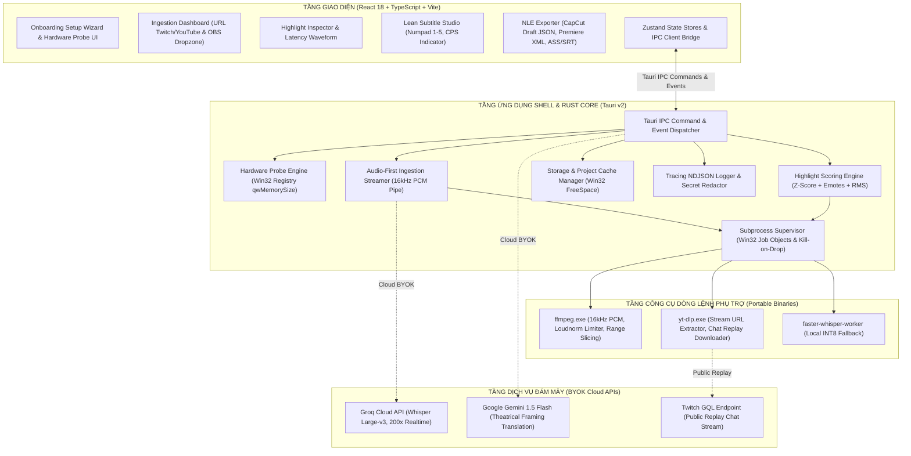

# NeuroClip — AI Subtitle Studio

<div align="center">

<!--

-->

**Desktop App chuyên biệt hóa cho Clipper & cộng đồng Swarm VN**  
*Đề xuất Highlight tiềm năng đa phương thức, STT, hỗ trợ vietsub cá thể hóa, cho phép xuất sang CapCut PC Draft, Adobe Premiere Pro & Aegisub...*

[](LICENSE)
[-0078D6?style=flat-square&logo=windows)](https://microsoft.com/windows)
[](https://v2.tauri.app/)
[](https://www.rust-lang.org/)
[](https://react.dev/)
[](https://www.typescriptlang.org/)
[](https://tailwindcss.com/)
[](src/test/)
[-orange?style=flat-square)](#-implementation-status-v1)

[Overview](#-tổng-quan-dự-án) •
[v1 Status](#-implementation-status-v1) •
[Implemented Features](#-tính-năng-đã-triển-khai-task-1---task-6) •
[Development Roadmap](#-development-roadmap-v1-task-7---task-32) •
[Architecture](#-architecture--tech-stack) •
[Install & Run](#-yêu-cầu-môi-trường--setup) •
[Folder Structure](#-folder-structure) •
[Contribution](#-contributing--governance) •
[License](#-license)

</div>

---

## 📖 Tổng quan dự án

**Neuro-sama** là AI VTuber tiên phong toàn cầu do Vedal phát triển. Cùng với **Evil Neuro**, Neuro-sama tạo nên một hiện tượng văn hóa livestream độc nhất vô nhị với sự đồng hành của cộng đồng "The Swarm".

Hiện tại quy trình clip hoàn toàn thủ công, có thể tốn nhiều giờ cho một vài clip ngắn. Một VOD có thể dài 4-8 giờ, việc lọc và trích xuất tự động moments tiềm năng giúp giảm thời gian tìm lại và crop cũng như có thể tìm được thêm những moments mới.

**NeuroClip** được phát triển như một **Windows Desktop Application siêu nhẹ** bán tự động hỗ trợ clip:
- **Audio-First Ingestion**: Trích xuất luồng âm thanh AAC trực tiếp từ VOD trực tuyến, tiết kiệm $\ge 98.5\%$ thời gian chờ, băng thông mạng, và dung lượng.
- **Multimodal Highlight Scoring**: Tính toán tương quan giữa chat Twitch (Z-Score hiệu chỉnh), tỷ lệ Emote, và Audio RMS bù độ trễ livestream 4.5 giây.
- **Hybrid AI Speech-to-Text**: Kết hợp Cloud Groq Whisper Large-v3 (200x) và Local Faster-Whisper INT8 ngoại tuyến với bộ lọc Silero VAD.
- **Theatrical Framing Vietsub**: Hỗ trợ dịch thuật LLM tích hợp Neuroverse Lore độc quyền và ma trận đại từ, nội suy bypass filter (optional).
- **Native NLE Timeline Export**: Export project folder **CapCut PC Draft JSON**, **Adobe Premiere Pro XML**. Dual Export Safeguard: luôn tự động sinh file phụ đề `.ass` (chuẩn màu char) + `.srt`.

---

## 📊 Implementation Status (v1)

Dự án hiện đang ở **Phase 4: Implementation & Verification** theo mô hình Single Source of Truth (SSOT). Tiến độ hiện tại đạt:

```text
[██████░░░░░░░░░░░░░░░░░░░░░░░░░░] 6 / 32 Tasks Hoàn thành (18.75% v1 Core)
433 Vitest Tests Passing • 75 Node Native Runner Tests Passing • Zero Unhandled Panics
```

| Nhóm Milestone | Phạm vi công việc | Số Task | Trạng thái |
|:---|:---|:---:|:---:|
| **M4.1: Foundation** | Shell Tauri v2, Giao thức mã lỗi IPC, Profiling phần cứng, Logging cấu trúc & Redaction | 4 / 4 | <kbd>ĐÃ HOÀN THÀNH (DONE)</kbd> |
| **M4.2: Ingestion & Chat** | Pre-flight disk check, Streamer Audio-First 16kHz PCM, Local Video Import, Twitch Chat Replay | 2 / 4 | <kbd>ĐANG THỰC HIỆN (2/4 DONE)</kbd> |
| **M4.3: Intelligence & Highlights** | Thuật toán Z-Score Chat, Emote Swarm Scorer, Audio RMS Peak, Multimodal Fusion, Range Slicer | 0 / 5 | <kbd>KẾ HOẠCH (PENDING)</kbd> |
| **M4.4: STT & VAD** | Silero VAD & Loudnorm Limiter, Groq Whisper Client, Faster-Whisper INT8 Worker | 0 / 3 | <kbd>KẾ HOẠCH (PENDING)</kbd> |
| **M4.5: Localization & Translation** | Gemini Flash Theatrical Framing, Từ điển Lore & Phân vai, Smart Vietnamese Line-Breaker | 0 / 3 | <kbd>KẾ HOẠCH (PENDING)</kbd> |
| **M4.6: Lean Subtitle Studio UI** | Timeline Video Player, Virtualized Subtitle List, Numpad Style Switcher, CPS Warning Lights | 0 / 4 | <kbd>KẾ HOẠCH (PENDING)</kbd> |
| **M4.7: Export Engine** | Aegisub .ASS / .SRT Exporter, CapCut PC Draft Generator, Premiere Pro / FCP7 XML Exporter | 0 / 3 | <kbd>KẾ HOẠCH (PENDING)</kbd> |
| **M4.8: System Integration** | Hardware Probe Engine, First-Run Onboarding Wizard, Managed Sidecars Auto-Updater | 0 / 3 | <kbd>KẾ HOẠCH (PENDING)</kbd> |
| **M4.9: E2E & Packaging** | E2E Synthetic Test Harness, Low-End PC Benchmark, Windows NSIS / MSI Packaging Pipeline | 0 / 3 | <kbd>KẾ HOẠCH (PENDING)</kbd> |
| **TỔNG CỘNG** | **Toàn bộ 9 Milestones thuộc giai đoạn v1 MVP** | **6 / 32** | **v1 In Progress** |

---

## ⚡ Tính năng đã triển khai (Task 1 - Task 6)

Mã nguồn của 6 tasks đầu tiên đã hoàn thành và được kiểm thử toàn diện qua 508 bài kiểm tra tự động:

### 1. Tauri v2 Desktop Foundation & Acrylic/Mica Dark Theme (`TASK-M4-01`)
- **Native Windows Shell**: Khởi chạy trên nền tảng Tauri v2 WebView2 với mức tiêu thụ RAM tĩnh $\le 90\text{MB}$ khi chạy không tải.
- **Neuro-sama Design System**: Bảng màu Dark Theme lấy cảm hứng từ nhân vật:
  - Nền chính: `#12131C` (Primary Dark), Nền phụ: `#1A1C28`, Thẻ chứa: `#24273A`, Viền: `#2E324A`
  - Accent Neuro (Hồng pastel): `#FFB6C1`
  - Accent Evil (Đỏ tươi): `#FF0055`
  - Accent Vedal (Xanh lá rùa): `#98FB98`
  - Accent Guest (Hổ phách): `#FFA726` | Accent Chat (Tím nhạt): `#B388FF`
- **Tùy biến cửa sổ**: Kích thước mặc định $1280 \times 800$ (kích thước tối thiểu $1024 \times 640$), hỗ trợ hiệu ứng Windows Acrylic / Mica material với cơ chế Fallback an toàn về Solid Color `#12131C` trên các bản Windows 10 cũ.

### 2. Unified Error Handling & Type-Safe IPC Error Protocol (`TASK-M4-02`)
- **Phân cấp lỗi toàn diện (Rust Backend)**: Triển khai enum `AppError` bằng `thiserror` với 39 mã lỗi canonical cố định (`ERR_INGEST_*`, `ERR_STT_*`, `ERR_HIGHLIGHT_*`, `ERR_TRANSLATE_*`, `ERR_EXPORT_*`, `ERR_STORAGE_*`, `ERR_CONFIG_*`).
- **Zero-Panic Invariant**: Áp dụng nghiêm ngặt các deny rule của Clippy (`clippy::unwrap_used`, `clippy::expect_used`, `clippy::panic`) trên toàn bộ crate backend; 100% các Tauri IPC command trả về `Result<T, AppError>`.
- **Đóng gói bao bì IPC Type-Safe**: Tự động chuyển đổi sang giao diện `IpcErrorResponse` cho TypeScript Frontend, đi kèm catalog mô tả tiếng Việt chi tiết và phân loại lỗi có thể phục hồi (`isRecoverableError`).
- **Giao diện phòng thủ React**: Bộ component `ErrorBoundary` và `ErrorBanner` hiển thị chi tiết kỹ thuật có thể thu gọn, tính năng sao chép lỗi 1-chạm vào Clipboard và nút kích hoạt thử lại (Retry).

### 3. Shared Types, Hardware Profiling & Atomic Config Management (`TASK-M4-03`)
- **Khảo sát phần cứng không nghẽn luồng**: Truy vấn thông số CPU cores, RAM khả dụng và GPU rời qua Windows Registry (`qwMemorySize`) trong vòng $\le 200\text{ms}$. Loại bỏ hoàn toàn lỗi tràn số VRAM 4095MB trên Windows và tự động ưu tiên card đồ họa NVIDIA CUDA rời trên hệ thống Optimus đa GPU.
- **Tuân thủ Data Contract Schema 5.1**: Sinh dữ liệu `hardware_profile.json` và phân loại tự động 3 chế độ vận hành: `cloud_byok`, `hybrid`, `offline_local`.
- **Ghi cấu hình đĩa nguyên tử (Atomic File Persistence)**: Ghi file cấu hình tạm thời với chuỗi entropy ngẫu nhiên (`pid`, `nonce`, `seq`), thực hiện `sync_all()` xả bộ nhớ đệm ổ cứng và đổi tên file nguyên tử ở cấp hệ điều hành (Atomic OS Rename), ngăn chặn triệt để nguy cơ file JSON bị 0-byte khi máy tính bị sập nguồn đột ngột.
- **Frontend Reactive Store**: Module Zustand `useSettingsStore` với cập nhật lạc quan (optimistic updates), cơ chế khóa chống lưu trùng lặp (save re-entrancy guard) và đồng bộ cấu hình qua IPC command có bảo vệ bằng `RwLock`.

### 4. Structured NDJSON Logging, Rotation & Privacy Secret Redaction (`TASK-M4-04`)
- **Structured NDJSON Tracing**: Hạ tầng ghi log bất đồng bộ không gây nghẽn luồng sử dụng `tracing` và `tracing-appender`, tự động xoay vòng file hàng ngày (`neuroclip-YYYY-MM-DD.log`).
- **Khử trùng thông tin nhạy cảm hai lớp (Dual-Layer Secret Redaction)**: Tự động quét regex và làm mờ (`[REDACTED]`) các chuỗi khóa API nhạy cảm trước khi ghi ra đĩa hoặc chuyển qua IPC:
  - Groq API Key (`gsk_*`), Google Gemini Key (`AIza*`), OpenAI Key (`sk-*`), Twitch OAuth tokens.
- **Bảo vệ dung lượng đĩa tự động**: Giới hạn thời gian lưu trữ tối đa 14 ngày; tự động dọn dẹp các tệp log cũ nhất xuống dưới 30MB khi tổng dung lượng thư mục log vượt quá ngưỡng trần 50MB.
- **Frontend Log Viewer**: Hàng đợi FIFO đệm log phía client (tự động xả khi đạt 25 bản ghi hoặc debounce 500ms, lập tức gửi nếu gặp sự kiện `ERROR`) và bộ đệm xoay vòng 1,000 dòng (`useLogStore`) hỗ trợ tìm kiếm và lọc mức độ nghiêm trọng.

### 5. Storage Pre-flight Check & Project Cache Management (`TASK-M4-05`)
- **Kiểm tra dung lượng đĩa trước khi tải**: Gọi trực tiếp Win32 kernel API `GetDiskFreeSpaceExW` kèm duyệt cây thư mục tổ tiên (Ancestor Traversal) với thời gian phản hồi $\le 1\text{ms}$ (không chạy tiến trình shell phụ).
- **Ngưỡng chặn an toàn 5GB (5120MB)**: Ngăn chặn tác vụ tải và trả về mã lỗi `ERR_INGEST_DISK_FULL` khi dung lượng ổ đĩa không đủ, bảo vệ hệ điều hành không bị đóng băng do tràn đĩa.
- **Không gian dự án cách ly**: Tự động quản lý cấu trúc thư mục tại `%LOCALAPPDATA%/NeuroClip/projects/<project_id>/` và thư mục đệm `cache/`, áp dụng thuật toán chuẩn hóa chống tấn công tràn đường dẫn (Path Traversal Sanitization).
- **Dọn dẹp bộ nhớ đệm thông minh**: Tự động thanh lọc các tệp tạm `.tmp` và `.wav` cũ hơn 7 ngày mà tuyệt đối bảo vệ các tệp dự án cốt lõi (`.json`, `.ass`, `.srt`, `.mp4`). Quản lý trạng thái bằng `useProjectStore` với monotonic sequence counter chống xung đột race condition.

### 6. Audio-First FFmpeg 16kHz PCM Ingestion Pipeline (`TASK-M4-06`)
- **Thu nạp luồng âm thanh không tải video**: Tích hợp `yt-dlp` và `ffmpeg` trích xuất luồng âm thanh trực tuyến từ URL Twitch VOD / YouTube VOD, tiết kiệm $\ge 98.5\%$ dung lượng mạng và ổ đĩa (VOD 8 tiếng 30GB video chuyển thành ~400MB audio AAC).
- **Transcoding trực tiếp sang 16kHz Mono PCM s16le**: Chuyển đổi định dạng âm thanh chuẩn hóa cho Whisper qua đường ống pipe `stdout` thời gian thực mà không ghi file trung gian dung lượng lớn.
- **Áp lực ngược giới hạn bộ nhớ (Bounded Backpressure)**: Hàng đợi `BoundedAudioQueue` giới hạn 16 khối $\times$ 64KB (~1MB RAM trần), áp lực trực tiếp lên pipe của hệ điều hành để hãm tốc độ giải mã của FFmpeg khớp với tốc độ tiêu thụ downstream.
- **Diệt trừ tiến trình ma (Zero Zombie Processes)**: Kết hợp cơ chế Tokio `kill_on_drop` với Windows Job Objects (`JOB_OBJECT_LIMIT_KILL_ON_JOB_CLOSE`), cam kết 100% tiến trình con `ffmpeg.exe` và `yt-dlp.exe` bị hủy sạch trong $\le 300\text{ms}$ khi NeuroClip bị tắt hoặc crash đột ngột.
- **Bảo toàn ranh giới mẫu âm thanh**: Module `AudioStreamValidator` lưu vết byte lẻ (carry-over byte) để bảo toàn ranh giới mẫu 2-byte PCM và tự động loại bỏ 44-byte WAV header mà không làm hỏng dữ liệu thô.
- **Cơ chế chống chặn bot YouTube**: Hỗ trợ nạp cookie trực tiếp từ trình duyệt (`--cookies-from-browser chrome/firefox/edge`), đọc tệp `cookies.txt` và xoay vòng User-Agent desktop Windows 10/11.
- **Chặn phát trực tiếp sớm**: Phát hiện và từ chối các luồng livestream chưa kết thúc (`is_live == true`) trong $\le 500\text{ms}$ với mã `ERR_INGEST_LIVE_STREAM_UNSUPPORTED`, ngăn nguy cơ ghi âm vô tận làm tràn ổ đĩa.
- **Giao diện Ingestion Dashboard**: Màn hình `IngestionDashboard` và store `useIngestionStore` cho phép dán URL, thăm dò metadata (tiêu đề, thời lượng, streamer), theo dõi thanh tiến độ tải 1Hz và xuất tệp giao kèo `vod_manifest.json` tuân thủ JSON Schema 5.2.

---

## 🗺️ Development Roadmap (v1): Task 7 - Task 32

Toàn bộ 26 tasks còn lại của phiên bản v1 đã được đặc tả chi tiết trong `docs/TASK_BOARD.md` và `docs/ARCHITECTURE.md`:

```mermaid
flowchart LR
    subgraph M42 ["M4.2: Ingestion & Chat"]
        T07["Task 07: Local Video Importer"]
        T08["Task 08: Twitch Chat GQL Parser"]
    end

    subgraph M43 ["M4.3: Intelligence & Highlights"]
        T09["Task 09: Z-Score Chat Velocity"]
        T10["Task 10: Swarm Emote Engine"]
        T11["Task 11: Audio RMS Peak Detector"]
        T12["Task 12: Multimodal Fusion & 4.5s Lag"]
        T13["Task 13: Precision Range Slicer"]
    end

    subgraph M44 ["M4.4: STT & VAD"]
        T14["Task 14: Silero VAD & Loudnorm"]
        T15["Task 15: Groq Whisper Client"]
        T16["Task 16: Local Faster-Whisper INT8"]
    end

    subgraph M45 ["M4.5: Localization & Translation"]
        T17["Task 17: Gemini Theatrical Framing"]
        T18["Task 18: Lore Dictionary & Diarization"]
        T19["Task 19: Smart VN Line-Breaker"]
    end

    subgraph M46 ["M4.6: Subtitle Studio UI"]
        T20["Task 20: Subtitle Studio Player"]
        T21["Task 21: Virtualized Segment List"]
        T22["Task 22: Numpad Style Switcher"]
        T23["Task 23: Visual CPS Warning Lights"]
    end

    subgraph M47 ["M4.7: Export Engine"]
        T24["Task 24: Aegisub .ASS / .SRT Export"]
        T25["Task 25: CapCut PC Draft Generator"]
        T26["Task 26: Premiere Pro XML Export"]
    end

    subgraph M48 ["M4.8: Integration"]
        T27["Task 27: Hardware Probe Engine"]
        T28["Task 28: Onboarding Wizard & DPAPI"]
        T29["Task 29: Sidecar Auto-Updater"]
    end

    subgraph M49 ["M4.9: Packaging"]
        T30["Task 30: E2E Synthetic Test Harness"]
        T31["Task 31: Low-End PC Benchmark"]
        T32["Task 32: Windows NSIS/MSI Packaging"]
    end

    M42 --> M43 --> M44 --> M45 --> M46 --> M47 --> M48 --> M49
```



### Chi tiết các Milestone tiếp theo:
- **Milestone M4.2: Luồng thu nạp mở rộng & Phân tích Chat**
  - **TASK-M4-07**: Trình nhập khẩu video cục bộ từ OBS (`.mp4`, `.mkv`) qua giao thức tùy biến `neuroclip-asset://`.
  - **TASK-M4-08**: Bộ tải và phân tích dữ liệu lịch sử Twitch Chat Replay JSON qua GQL endpoint (`chat_events.json` Schema 5.3).
- **Milestone M4.3: Động cơ trí tuệ phát hiện Highlight đa phương thức**
  - **TASK-M4-09**: Thuật toán tính điểm tốc độ chat Z-Score hiệu chỉnh kèm ngưỡng sàn tin nhắn ($X \ge 15$ tin nhắn / 5 giây, $\epsilon = 0.5$).
  - **TASK-M4-10**: Động cơ chấm điểm trọng số Emote đặc thù văn hóa Neuro Swarm (*KEKW, Tutel, Dinking, Aware, Clueless, Erm*).
  - **TASK-M4-11**: Bộ quét đỉnh biên độ năng lượng âm thanh (Audio RMS Peak Detector) làm cứu cánh khi VOD bị tắt chat.
  - **TASK-M4-12**: Hợp nhất đa phương thức, tự động bù độ trễ phát trực tiếp 4.5 giây ($t_{event} = t_{chat} - 4.5s - 10s$).
  - **TASK-M4-13**: Bộ tải phân đoạn video chính xác không tải thừa (Lossless Precision Range Slicer qua HTTP Range Request).
- **Milestone M4.4: Động cơ nhận diện giọng nói & Tách thoại (STT & VAD)**
  - **TASK-M4-14**: Tiền xử lý âm thanh lọc khoảng lặng Silero VAD và bộ lọc chuẩn hóa biên độ FFmpeg `loudnorm` limiter chống vỡ tiếng hét.
  - **TASK-M4-15**: Máy khách Groq Whisper Cloud API (Whisper Large-v3, chia nhỏ chunk $<25$MB, Karaoke Mode `condition_on_previous_text=False` phá vỡ lặp từ ảo giác).
  - **TASK-M4-16**: Trình xử lý ngoại tuyến Faster-Whisper INT8 dự phòng trên máy khi mất mạng.
- **Milestone M4.5: Bản địa hóa, Ngữ cảnh Lore & Dịch thuật Vietsub**
  - **TASK-M4-17**: Máy khách Google Gemini 1.5 Flash đóng gói Prompt kịch bản sân khấu ("Theatrical Framing", `BLOCK_NONE`), bảo lưu câu gốc khi gặp kiểm duyệt nhạy cảm.
  - **TASK-M4-18**: Từ điển thuật ngữ Neuro Lore, ma trận đại từ xưng hô (Vedal: Rùa/Bố, Neuro: Con gái, Evil: Em gái) và tự động gán vai ngữ cảnh.
  - **TASK-M4-19**: Động cơ ngắt dòng thông minh tiếng Việt bảo toàn từ ghép và tối ưu hóa tốc độ đọc (CPS $\le 20$).
- **Milestone M4.6: Trình soạn thảo phụ đề tinh gọn (Lean Subtitle Studio UI)**
  - **TASK-M4-20**: Màn hình biên tập Subtitle Studio và khung xem video đồng bộ mốc thời gian Timeline.
  - **TASK-M4-21**: Danh sách phụ đề ảo hóa (Virtualized Segment List) duy trì 60 FPS mượt mà.
  - **TASK-M4-22**: Bàn phím số 1-chạm đổi phong cách nhân vật (`1`: Vedal, `2`: Neuro, `3`: Evil, `4`: Collab, `5`: Chat).
  - **TASK-M4-23**: Đèn cảnh báo tốc độ đọc trực quan và trợ lý phím tắt nới rộng thời gian (`A`/`D` dịch $\pm 100\text{ms}$).
- **Milestone M4.7: Phân hệ xuất bản đa nền tảng & Tích hợp NLE**
  - **TASK-M4-24**: Bộ xuất phụ đề chuẩn Aegisub (`.ass` mã màu phong cách) và phụ đề quốc tế (`.srt`).
  - **TASK-M4-25**: Bộ sinh thư mục dự án CapCut PC Draft JSON (`draft_content.json`) kèm chiến lược phòng thủ kép (**Dual Export Safeguard** luôn sinh kèm `.ass` và `.srt`).
  - **TASK-M4-26**: Bộ xuất dòng thời gian Adobe Premiere Pro XML & Final Cut Pro 7 XML.
- **Milestone M4.8: Khởi động lần đầu, Bảo mật Keyring & Quản lý Sidecars**
  - **TASK-M4-27**: Tích hợp UI đề xuất cấu hình phần cứng thông minh từ `HardwareProbeEngine`.
  - **TASK-M4-28**: Giao diện First-Run Onboarding Wizard và lưu trữ an toàn API key vào Windows Credential Locker (DPAPI).
  - **TASK-M4-29**: Bộ quản lý và tự động cập nhật ngầm `yt-dlp` từ GitHub Releases khi YouTube đổi thuật toán.
- **Milestone M4.9: Kiểm thử End-to-End & Đóng gói bộ cài Windows**
  - **TASK-M4-30**: Bộ kiểm thử tự động tích hợp toàn tuyến (E2E Synthetic Pipeline Harness).
  - **TASK-M4-31**: Bộ đánh giá hiệu năng và tải nặng trên máy tính cấu hình yếu (Low-End PC Stress Benchmark).
  - **TASK-M4-32**: Pipeline đóng gói bộ cài đặt Windows NSIS và MSI chính thức.

---

## 🏗️ ARchitecture & Tech Stack

Hệ thống được tổ chức thành 4 phân tầng độc lập theo tài liệu kiến trúc chuẩn `docs/ARCHITECTURE.md`:



### Tech Stack:

| Thành phần | Công nghệ / Thư viện | Vai trò & Mục đích sử dụng |
|:---|:---|:---|
| **Desktop Shell** | [Tauri v2](https://v2.tauri.app/) (`@tauri-apps/api`, `@tauri-apps/plugin-opener`) | Shell native WebView2 siêu nhẹ, bảo toàn RAM tĩnh $\le 90\text{MB}$. |
| **Backend Core** | [Rust](https://www.rust-lang.org/) (Edition 2021, Target `stable-x86_64-pc-windows-msvc`) | Logic xử lý I/O tốc độ cao, quản lý bộ nhớ an toàn tuyệt đối. |
| **Async Runtime** | [Tokio v1.38](https://tokio.rs/) (`features = ["full"]`), `tokio-util` | Xử lý bất đồng bộ, stream stdout/stderr tiến trình qua bounded channels. |
| **Windows APIs** | `windows-sys` v0.52 (Win32_Storage_FileSystem, Win32_System_JobObjects, Win32_Security...) | Truy vấn dung lượng đĩa `GetDiskFreeSpaceExW`, diệt tiến trình con triệt để bằng Job Objects. |
| **Data Serialization** | `serde` v1.0, `serde_json` v1.0 | Tuần tự hóa JSON Schemas (5.1 đến 5.6) giao tiếp qua IPC. |
| **Backend Logging** | `tracing` v0.1, `tracing-subscriber` v0.3, `tracing-appender` v0.2 | Structured NDJSON logging, xoay vòng hàng ngày và bảo vệ dung lượng đĩa $\le 50\text{MB}$. |
| **Error Handling** | `thiserror` v1.0 | Định nghĩa cây lỗi phân cấp `AppError` và chuẩn hóa 39 mã lỗi canonical. |
| **Frontend Framework** | [React 18.3](https://react.dev/), [TypeScript 5.6](https://www.typescriptlang.org/) (Strict Mode) | Giao diện người dùng SPA hiện đại, kiểm tra kiểu nghiêm ngặt (Zero-any). |
| **UI & Styling** | [Tailwind CSS 3.4](https://tailwindcss.com/), `clsx`, `tailwind-merge`, [Lucide Icons](https://lucide.dev/) | Hệ thống thiết kế Dark Theme Neuro-sama với Acrylic/Mica backdrop. |
| **State Management** | [Zustand](https://github.com/pmndrs/zustand) | Quản lý trạng thái client nhẹ, chống race condition bằng sequence counters. |
| **Build & Tooling** | [Vite 4.3](https://vitejs.dev/), PostCSS, Autoprefixer, ESLint 9, Prettier | Đóng gói giao diện tốc độ cao, linter tuân thủ Flat Config. |
| **Testing Harness** | [Vitest 2.1](https://vitest.dev/), `@testing-library/react`, Node.js native test runner (`--test`) | 508 bài kiểm tra tự động (Unit, Integration, Contract, Adversarial Stress). |
| **Portable Sidecars** | `ffmpeg.exe` (v6.0+), `yt-dlp.exe` (latest) | Trích xuất âm thanh trực tuyến, xử lý mẫu PCM 16kHz, cào chat replay Twitch. |

### Data Contracts & JSON Schemas (SSOT):
Mọi dữ liệu trao đổi giữa Rust Backend và TypeScript Frontend đều tuân thủ các schema tĩnh quy định tại Mục 5 `docs/ARCHITECTURE.md`:
- **`hardware_profile.json` (§5.1)**: Thông số CPU, RAM, GPU VRAM và chế độ đề xuất (`cloud_byok`, `hybrid`, `offline_local`).
- **`vod_manifest.json` (§5.2)**: Metadata video VOD, loại nguồn (`twitch_vod`, `youtube_vod`, `local_file`), đường dẫn file audio AAC/PCM và thời lượng.
- **`chat_events.json` (§5.3)**: Danh sách sự kiện chat Twitch chuẩn hóa mốc giây `timestamp_sec`, tác giả, nội dung và danh sách Emote Swarm.
- **`highlight_clusters.json` (§5.4)**: Danh sách các cụm highlight xếp hạng theo điểm số (Score 0–100), Z-score, Audio RMS và lý do nổi bật.
- **`transcript_segments.json` (§5.5)**: Lời thoại bóc băng kèm mốc thời gian In/Out, người nói (`vedal`, `neuro`, `evil`, `guest`, `chat`), văn bản tiếng Anh và Vietsub.
- **`subtitle_project.json` (§5.6)**: Toàn bộ cấu hình dự án phụ đề, layout hiển thị (16:9, 9:16 Center-Crop, 9:16 Two-Stack) và style bảng màu nhân vật.

---

## 💻 Yêu cầu môi trường & Setup

### 1. Yêu cầu hệ thống (Prerequisites)
- **Hệ điều hành**: Windows 10 (bản 2004 trở lên) hoặc Windows 11 (64-bit).
- **Node.js**: Phiên bản `v20.x` hoặc `v22.x` (LTS khuyến nghị) kèm `npm >= 10.x`.
- **Rust Toolchain**: `rustc >= 1.78.0` và `cargo` (kênh stable, target `x86_64-pc-windows-msvc`).
- **Visual Studio Build Tools**: C++ build tools (MSVC v142/v143) và Windows 10/11 SDK.
- **WebView2 Runtime**: Đã tích hợp sẵn trên Windows 11 và Windows 10 bản mới.
- **Sidecar Binaries (Công cụ phụ trợ)**:
  - `ffmpeg.exe` và `yt-dlp.exe` (được cấu hình trong PATH hệ thống hoặc đặt trong thư mục `%LOCALAPPDATA%/NeuroClip/bin/`).

### 2. Cài đặt các gói phụ thuộc (Dependencies)
Mở PowerShell hoặc terminal tại thư mục gốc của dự án:

```powershell
npm install
```

### 3. Chạy môi trường phát triển (Development)
Khởi chạy đồng thời Vite dev server và Tauri desktop app:

```powershell
npm run tauri dev
```

Nếu chỉ muốn phát triển và kiểm thử riêng giao diện web trên trình duyệt:

```powershell
npm run dev
```
*(Truy cập tại: `http://localhost:1420`)*

### 4. Kiểm thử tự động & Đảm bảo chất lượng (Quality Assurance)
Dự án áp dụng quy chuẩn kiểm thử nghiêm ngặt, bao gồm cả các kịch bản tấn công dồn dập (Adversarial Stress Testing):

```powershell
# Chạy bộ test tích hợp bằng Node.js Native Test Runner (75 tests)
npm test

# Chạy toàn bộ 433 bài kiểm thử bằng Vitest (Unit, Component, Adversarial)
npm run test:vitest

# Kiểm tra kiểu dữ liệu TypeScript nghiêm ngặt (Zero-any Invariant)
npm run typecheck

# Quét lỗi cú pháp và kiểm tra định dạng code
npm run lint
npm run format
```

### 5. Đóng gói bản cài đặt Production (Build Release)
```powershell
# Biên dịch giao diện frontend sang thư mục dist/
npm run build

# Biên dịch mã nguồn Rust và đóng gói bộ cài đặt Windows (.exe / .msi)
npm run tauri build
```
File cài đặt sau khi đóng gói sẽ nằm tại: `src-tauri/target/release/bundle/nsis/` hoặc `msi/`.

---

## 📁 Folder Structure

```text
neuroclip/
├── .agents/                    # Bộ quy chuẩn và skills dành cho Multi-Agent Team
│   └── skills/                 # Skills hỗ trợ lập trình, tài liệu và frontend design
├── docs/                       # TÀI LIỆU SSOT (Single Source of Truth)
│   ├── adr/                    # 7 Architectural Decision Records chính thức (ADR-001 -> ADR-007)
│   ├── ARCHITECTURE.md         # Đặc tả kiến trúc hệ thống, data contracts, failure modes
│   ├── CONVENTIONS.md          # Tiêu chuẩn code Rust/TypeScript, clippy lint, IPC protocol
│   ├── PRD.md                  # Tài liệu yêu cầu sản phẩm, chân dung người dùng, epics
│   └── TASK_BOARD.md           # Bảng theo dõi tiến độ chi tiết 32 tasks và 9 milestones
├── scripts/                    # Scripts tự động hóa hỗ trợ phát triển (icon generator...)
├── src/                        # FRONTEND TYPESCRIPT & REACT SPA
│   ├── components/             # React UI Components
│   │   ├── common/             # ErrorBoundary, ErrorBanner, Buttons dùng chung
│   │   └── dashboard/          # IngestionDashboard, Video Dropzone, Metadata Preview
│   ├── services/               # Tầng dịch vụ kết nối và gọi IPC
│   │   ├── config/             # Hardware probing client, App settings client
│   │   ├── ipc/                # IPC Error envelope, Ingestion IPC, Storage IPC
│   │   └── logging/            # Client logging service, Token redactor, Logger store bridge
│   ├── stores/                 # Zustand Stores (useIngestionStore, useProjectStore, useLogStore...)
│   ├── styles/                 # Theme tokens, globals.css, Neuro-sama color palettes
│   └── test/                   # Test Suites (Adversarial stress tests, Unit tests, Node runner)
├── src-tauri/                  # BACKEND RUST CORE (TAURI V2 NATIVE)
│   ├── icons/                  # Bộ biểu tượng ứng dụng đa kích thước cho Windows
│   ├── src/                    # Mã nguồn Rust
│   │   ├── commands/           # Các hàm Tauri IPC Command (`config_cmd`, `ingest_cmd`, `storage_cmd`...)
│   │   ├── config/             # Quản lý cấu hình nguyên tử (atomic file writes) & Hardware probe
│   │   ├── core/               # Quản lý lưu trữ đĩa (Win32 FreeSpace) & Thư mục dự án
│   │   ├── error/              # Cây lỗi phân cấp `AppError` và 39 mã lỗi `ERR_*`
│   │   ├── ingestion/          # Động cơ Audio-First streaming, BoundedQueue, Cookie/UA rotation
│   │   ├── logging/            # Hạ tầng Tracing NDJSON, xoay vòng log, lọc secret redaction
│   │   ├── lib.rs              # Khởi tạo AppState, đăng ký IPC handlers, clippy denies
│   │   └── main.rs             # Điểm vào thực thi ứng dụng Windows desktop
│   ├── Cargo.toml              # Khai báo crate dependencies, target Windows Win32 APIs
│   ├── rustfmt.toml            # Quy chuẩn format code Rust chuẩn Windows newline
│   └── tauri.conf.json         # Cấu hình cửa sổ, định dạng Acrylic/Mica, bundle metadata
├── AGENTS.md                   # Hiến pháp vận hành Multi-Agent & Nguyên tắc Zero-Guesswork
├── LICENSE                     # Bản quyền mã nguồn mở GNU AGPLv3
├── package.json                # Khai báo dependencies npm và các script thực thi
├── tailwind.config.js          # Khai báo theme tokens và bảng màu Neuro-sama cho Tailwind
├── tsconfig.json               # Cấu hình TypeScript Strict Mode mức tối đa
└── vite.config.ts              # Cấu hình đóng gói Vite cho Tauri v2
```

---

## 🤝 Contributing & Governance

1. **Single Source of Truth (SSOT)**:
   - Kiến trúc hệ thống: [`docs/ARCHITECTURE.md`](docs/ARCHITECTURE.md)
   - Tiêu chuẩn lập trình & Error Protocol: [`docs/CONVENTIONS.md`](docs/CONVENTIONS.md)
   - Đặc tả yêu cầu & Phạm vi sản phẩm: [`docs/PRD.md`](docs/PRD.md)
   - Tiến độ thực tế & QA Checklist: [`docs/TASK_BOARD.md`](docs/TASK_BOARD.md)
2. **Quy chuẩn Code Quality**:
   - Rust: Không có bất kỳ dòng lệnh `.unwrap()`, `.expect()` hay unhandled panic nào trong luồng sản phẩm (`clippy::all`, `clippy::pedantic`).
   - TypeScript: Khóa chặt `strict: true` và `noImplicitAny: true`, 0 xuất hiện của kiểu dữ liệu `any`.
   - Bảo mật: 100% các chuỗi API Key và Auth Token phải được lọc qua bộ khử trùng `redact_secret` trước khi lưu vết.

### Nếu bạn đóng góp với sự hỗ trợ của AI Agents
NeuroClip hiện đang duy trì **Multi-Agent Operating Constitution** quy định tại [`AGENTS.md`](AGENTS.md), chúng tôi khuyến khích sử dụng chế độ Multi-Agent (hay Teamwork) để hỗ trợ phát triển, bổ sung pipeline dành cho Agent đơn thông thường sẽ được cập nhật sau. Nếu bạn sử dụng Agent đơn, hãy tùy chỉnh pipeline theo cách mà bạn tự thấy làm việc hiệu quả và chính xác nhất, nhưng bắt buộc phải nạp đầy đủ `docs/`. Đối với Multi-Agent, hãy lưu ý tuân thủ thêm:

3. **Zero-Guesswork Policy**: Tuyệt đối không suy đoán khi gặp các ngã rẽ kiến trúc hoặc quyết định công nghệ. Mọi giải pháp phân vân đều phải lập RFC trong `docs/adr/` và chờ phản hồi chính thức từ Product Owner.
4. **Quy tắc Gate Checks**: Mã nguồn chỉ được triển khai khi đã vượt qua các cổng phê duyệt kiểm định nghiêm ngặt từ `@lead-architect`, `@tech-lead` và `@qa-reviewer`.


Bạn muốn đóng góp tính năng mới hoặc báo cáo lỗi? Vui lòng đối chiếu kỹ [`docs/CONVENTIONS.md`](docs/CONVENTIONS.md) trước khi gửi Pull Request.

---

## 📜 License

Dự án này được phát hành dưới giấy phép mã nguồn mở **GNU Affero General Public License v3.0 (AGPL-3.0)**.  
Xem toàn văn giấy phép tại [`LICENSE`](LICENSE).

```text
NeuroClip — AI Subtitle Studio
Copyright (C) 2026 Nashidiwa

This program is free software: you can redistribute it and/or modify
it under the terms of the GNU Affero General Public License as published by
the Free Software Foundation, either version 3 of the License, or
(at your option) any later version.
```

---

<div align="center">

🐢 Heart Heart Heart ✨

</div>
