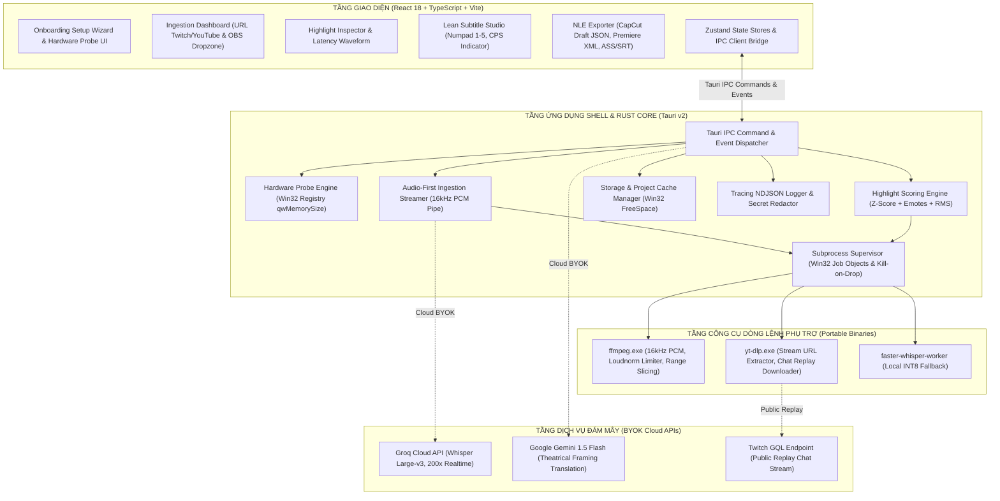

# NeuroClip — AI Subtitle Studio

<div align="center">

<!--

-->

**Desktop App chuyên biệt hóa cho Clipper & cộng đồng Swarm VN**  
*Đề xuất Highlight tiềm năng đa phương thức, STT, hỗ trợ vietsub cá thể hóa, cho phép xuất sang CapCut PC Draft, Adobe Premiere Pro & Aegisub...*

[](LICENSE)
[-0078D6?style=flat-square&logo=windows)](https://microsoft.com/windows)
[](https://v2.tauri.app/)
[](https://www.rust-lang.org/)
[](https://react.dev/)
[](https://www.typescriptlang.org/)
[](https://tailwindcss.com/)
[](src/test/)
[-orange?style=flat-square)](#-current-implementation)

[Overview](#-tổng-quan-dự-án) •
[Current Implementation](#-current-implementation) •
[Milestone Roadmap](#️-lộ-trình-phát-triển-v1-milestone-roadmap) •
[Architecture](#️-architecture--tech-stack) •
[Install & Run](#-yêu-cầu-môi-trường--setup) •
[Folder Structure](#-folder-structure) •
[Contribution](#-contributing--governance) •
[License](#-license)

</div>

---

## 📖 Tổng quan dự án

**Neuro-sama** là AI VTuber tiên phong toàn cầu do Vedal phát triển. Cùng với **Evil Neuro**, Neuro-sama tạo nên một hiện tượng văn hóa livestream độc nhất vô nhị với sự đồng hành của cộng đồng "The Swarm".

Hiện tại quy trình clip hoàn toàn thủ công, có thể tốn nhiều giờ cho một vài clip ngắn. Một VOD có thể dài 4-8 giờ, việc lọc và trích xuất tự động moments tiềm năng giúp giảm thời gian tìm lại và crop cũng như có thể tìm được thêm những moments mới.

**NeuroClip** được phát triển như một **Windows Desktop Application siêu nhẹ** bán tự động hỗ trợ clip:
- **Audio-First Ingestion**: Trích xuất luồng âm thanh AAC trực tiếp từ VOD trực tuyến, tiết kiệm $\ge 98.5\%$ thời gian chờ, băng thông mạng, và dung lượng.
- **Multimodal Highlight Scoring**: Tính toán tương quan giữa chat Twitch (Z-Score hiệu chỉnh), tỷ lệ Emote, và Audio RMS bù độ trễ livestream 4.5 giây.
- **Hybrid AI Speech-to-Text**: Kết hợp Cloud Groq Whisper Large-v3 (200x) và Local Faster-Whisper INT8 ngoại tuyến với bộ lọc Silero VAD.
- **Theatrical Framing Vietsub**: Hỗ trợ dịch thuật LLM tích hợp Neuroverse Lore độc quyền và ma trận đại từ, nội suy bypass filter (optional).
- **Native NLE Timeline Export**: Export project folder **CapCut PC Draft JSON**, **Adobe Premiere Pro XML**. Dual Export Safeguard: luôn tự động sinh file phụ đề `.ass` (chuẩn màu char) + `.srt`.

---

## ⚡ Current Implementation

Dự án hiện đang ở **Phase 4: Implementation & Verification** theo mô hình Single Source of Truth (SSOT). Tiến độ hiện tại đạt:

```text
[██████░░░░░░░░░░░░░░░░░░░░░░░░░░] 6 / 32 Tasks Hoàn thành (18.75% v1 Core)
433 Vitest Tests Passing • 75 Node Native Runner Tests Passing • Zero Unhandled Panics
```

6 tasks nền tảng đầu tiên đã hoàn thành và được kiểm thử toàn diện:

- **Desktop Shell & Neuro Design (`TASK-M4-01`)**:
  - Chạy native trên Windows 10/11 qua Tauri v2 (WebView2) với mức chiếm dụng RAM tĩnh $\le 90\text{MB}$.
  - Giao diện Dark Theme lấy cảm hứng từ nhân vật Neuro-sama (`#12131C`, `#1A1C28`, Accent Pink `#FFB6C1`, Evil `#FF0055`, Vedal `#98FB98`), hỗ trợ hiệu ứng Acrylic/Mica và tự động fallback về màu đặc an toàn.
- **Xử lý lỗi hợp nhất & Giao thức IPC (`TASK-M4-02`)**:
  - Enum `AppError` (`thiserror`) chuẩn hóa 39 mã lỗi định danh (`ERR_*`), thực thi chính sách zero-panic tĩnh trên Rust backend.
  - Tự động đóng gói `IpcErrorResponse` cho TypeScript kèm giải thích tiếng Việt và phân loại lỗi có thể phục hồi; React `ErrorBoundary` và `ErrorBanner` hiển thị thông báo thân thiện và nút thử lại (Retry).
- **Thăm dò phần cứng & Quản lý cấu hình nguyên tử (`TASK-M4-03`)**:
  - Truy vấn CPU, RAM và GPU VRAM rời qua Windows Registry (`qwMemorySize`) trong $\le 200\text{ms}$, triệt tiêu lỗi tràn số 4095MB VRAM và tương thích chuẩn Schema 5.1 (`hardware_profile.json`).
  - Ghi cấu hình đĩa nguyên tử (Atomic OS Rename + `sync_all()`) chống mất dữ liệu hoặc hỏng file JSON khi sập nguồn đột ngột; quản lý cấu hình bằng `useSettingsStore` có khóa chống ghi đè đồng thời.
- **Ghi log cấu trúc & Che giấu thông tin nhạy cảm (`TASK-M4-04`)**:
  - Structured NDJSON logging bất đồng bộ bằng `tracing`, tự động xoay vòng file hàng ngày (`neuroclip-YYYY-MM-DD.log`), lưu tối đa 14 ngày và giới hạn thư mục log $\le 50\text{MB}$.
  - Bộ lọc bảo mật 2 lớp tự động che giấu (`[REDACTED]`) các API Key (Groq `gsk_*`, Gemini `AIza*`, OpenAI `sk-*`) và Twitch OAuth Token trước khi ghi đĩa hoặc gửi qua IPC; UI Log Viewer có hàng đợi FIFO và ring-buffer 1,000 dòng.
- **Kiểm tra dung lượng đĩa & Bộ nhớ đệm dự án (`TASK-M4-05`)**:
  - Gọi Win32 kernel `GetDiskFreeSpaceExW` trực tiếp ($\le 1\text{ms}$); chặn tác vụ tải và trả về mã `ERR_INGEST_DISK_FULL` khi ổ đĩa còn dưới 5GB trống để bảo vệ hệ điều hành.
  - Quản lý không gian làm việc dự án cách ly tại `%LOCALAPPDATA%/NeuroClip/`, chuẩn hóa chống path traversal và tự động dọn dẹp cache `.tmp`/`.wav` an toàn mà không ảnh hưởng tệp dự án cốt lõi (`.json`, `.ass`, `.srt`, `.mp4`).
- **Pipeline Audio-First Ingestion (`TASK-M4-06`)**:
  - Thu nạp luồng âm thanh trực tiếp từ URL Twitch/YouTube VOD bằng `yt-dlp` và transcode sang 16kHz mono PCM qua FFmpeg stdout pipe, tiết kiệm $\ge 98.5\%$ dung lượng mạng và ổ đĩa (VOD 8h 30GB video chỉ tiêu tốn ~400MB audio).
  - Áp dụng hàng đợi `BoundedAudioQueue` giới hạn RAM $\le 1\text{MB}$, cơ chế diệt tiến trình con triệt để (Tokio `kill_on_drop` + Windows Job Object) đảm bảo 0 zombie process khi tắt app; hỗ trợ nạp cookie trình duyệt và xoay vòng User-Agent chống bot YouTube; màn hình `IngestionDashboard` theo dõi tiến độ tải thời gian thực.

---

## 🗺️ Lộ trình phát triển (v1 Milestone Roadmap)

Toàn bộ 32 tasks của v1 được tổ chức thành 9 Milestones tuần tự. Quá trình phát triển tuân thủ luồng dữ liệu đầu-cuối:

```mermaid
flowchart LR
    subgraph M41 ["M4.1: Foundation"]
        F1["Shell & IPC"]
        F2["Config & Logs"]
    end

    subgraph M42 ["M4.2: Ingestion & Chat"]
        I1["Audio-First Stream"]
        I2["Chat Replay Parser"]
    end

    subgraph M43 ["M4.3: Highlights"]
        H1["Z-Score & Emotes"]
        H2["Audio RMS & Slicing"]
    end

    subgraph M44 ["M4.4: STT & VAD"]
        S1["Silero VAD"]
        S2["Groq & Faster-Whisper"]
    end

    subgraph M45 ["M4.5: Vietsub & Lore"]
        L1["Theatrical Framing"]
        L2["Swarm Lore & Diarization"]
    end

    subgraph M46 ["M4.6: Subtitle Studio"]
        U1["Timeline Player"]
        U2["Numpad Styling & CPS"]
    end

    subgraph M47 ["M4.7: NLE Export"]
        E1["CapCut PC Draft"]
        E2["Premiere XML & ASS"]
    end

    subgraph M48 ["M4.8: Integration"]
        G1["Onboarding Wizard"]
        G2["DPAPI Key Vault"]
    end

    subgraph M49 ["M4.9: Packaging"]
        P1["E2E Benchmark"]
        P2["NSIS/MSI Installer"]
    end

    M41 --> M42 --> M43 --> M44 --> M45 --> M46 --> M47 --> M48 --> M49
```



### 🚀 Bảng tiến độ Milestone & Hạng mục bàn giao (Deliverables Matrix)

| Cột mốc | Phân hệ / Mục tiêu | Key Deliverables | Tasks | Trạng thái |
|:---|:---|:---|:---:|:---:|
| **M4.1** | **Nền tảng cốt lõi (Foundation)** | Tauri v2 Acrylic Shell, Giao thức IPC Error, Win32 Hardware Profiler, Tracing NDJSON & Secret Redaction | **4 / 4** | <kbd>ĐÃ HOÀN THÀNH</kbd> |
| **M4.2** | **Thu nạp VOD & Phân tích Chat** | Audio-First 16kHz PCM streamer, Pre-flight disk check 5GB, Local video asset streamer, Twitch GQL chat parser | **2 / 4** | <kbd>ĐANG THỰC HIỆN</kbd> |
| **M4.3** | **Động cơ Highlight đa phương thức** | Thuật toán Chat Velocity Z-Score, Bộ lọc Emote Swarm, Quét đỉnh âm thanh RMS, Bù trễ stream 4.5s, Lossless range slicer | **0 / 5** | ⏳ *Planned* |
| **M4.4** | **Bóc băng giọng nói & Tách thoại** | Silero VAD, FFmpeg loudnorm limiter, Groq Whisper Large-v3 client (<25MB chunks), Faster-Whisper INT8 offline worker | **0 / 3** | ⏳ *Planned* |
| **M4.5** | **Bản địa hóa & Vietsub Swarm Lore** | Gemini 1.5 Flash Theatrical Framing (`BLOCK_NONE`), Từ điển Swarm Lore, Ma trận xưng hô nhân vật, Smart line-breaker | **0 / 3** | ⏳ *Planned* |
| **M4.6** | **Trình biên tập Subtitle Studio UI** | Canvas video sync timeline, Virtualized subtitle list 60fps, Bàn phím số 1-chạm đổi màu nhân vật, Đèn cảnh báo CPS | **0 / 4** | ⏳ *Planned* |
| **M4.7** | **Xuất bản NLE đa nền tảng** | Xuất Aegisub .ASS (chuẩn màu style), .SRT, CapCut PC Draft JSON (Dual Export safeguard), Adobe Premiere Pro XML | **0 / 3** | ⏳ *Planned* |
| **M4.8** | **Tích hợp hệ thống & Bảo mật** | Hardware probe recommendation UI, First-run setup wizard, Windows DPAPI Credential Locker, Sidecar auto-updater | **0 / 3** | ⏳ *Planned* |
| **M4.9** | **Kiểm thử E2E & Đóng gói bộ cài** | E2E synthetic pipeline test harness, Low-end PC stress benchmark (<100MB RAM), Bộ cài đặt Windows NSIS / MSI chính thức | **0 / 3** | ⏳ *Planned* |
| **TỔNG** | **Toàn bộ 9 Milestones thuộc v1 MVP** | **Cam kết zero-panic backend, zero-any frontend, coverage 100% contracts** | **6 / 32** | **18.75% Complete** |

> 💡 **Single Source of Truth:** Chi tiết đặc tả kỹ thuật, tiêu chí nghiệm thu định lượng (AC) và QA checklist của toàn bộ 32 tasks (TASK-M4-01 đến TASK-M4-32) được theo dõi tập trung tại [`docs/TASK_BOARD.md`](docs/TASK_BOARD.md).

---

## 🏗️ Architecture & Tech Stack

Hệ thống được tổ chức thành 4 phân tầng độc lập theo tài liệu kiến trúc chuẩn `docs/ARCHITECTURE.md`:



### Tech Stack:

| Thành phần | Công nghệ / Thư viện | Vai trò & Mục đích sử dụng |
|:---|:---|:---|
| **Desktop Shell** | [Tauri v2](https://v2.tauri.app/) (`@tauri-apps/api`, `@tauri-apps/plugin-opener`) | Shell native WebView2 siêu nhẹ, bảo toàn RAM tĩnh $\le 90\text{MB}$. |
| **Backend Core** | [Rust](https://www.rust-lang.org/) (Edition 2021, Target `stable-x86_64-pc-windows-msvc`) | Logic xử lý I/O tốc độ cao, quản lý bộ nhớ an toàn tuyệt đối. |
| **Async Runtime** | [Tokio v1.38](https://tokio.rs/) (`features = ["full"]`), `tokio-util` | Xử lý bất đồng bộ, stream stdout/stderr tiến trình qua bounded channels. |
| **Windows APIs** | `windows-sys` v0.52 (Win32_Storage_FileSystem, Win32_System_JobObjects, Win32_Security...) | Truy vấn dung lượng đĩa `GetDiskFreeSpaceExW`, diệt tiến trình con triệt để bằng Job Objects. |
| **Data Serialization** | `serde` v1.0, `serde_json` v1.0 | Tuần tự hóa JSON Schemas (5.1 đến 5.6) giao tiếp qua IPC. |
| **Backend Logging** | `tracing` v0.1, `tracing-subscriber` v0.3, `tracing-appender` v0.2 | Structured NDJSON logging, xoay vòng hàng ngày và bảo vệ dung lượng đĩa $\le 50\text{MB}$. |
| **Error Handling** | `thiserror` v1.0 | Định nghĩa cây lỗi phân cấp `AppError` và chuẩn hóa 39 mã lỗi canonical. |
| **Frontend Framework** | [React 18.3](https://react.dev/), [TypeScript 5.6](https://www.typescriptlang.org/) (Strict Mode) | Giao diện người dùng SPA hiện đại, kiểm tra kiểu nghiêm ngặt (Zero-any). |
| **UI & Styling** | [Tailwind CSS 3.4](https://tailwindcss.com/), `clsx`, `tailwind-merge`, [Lucide Icons](https://lucide.dev/) | Hệ thống thiết kế Dark Theme Neuro-sama với Acrylic/Mica backdrop. |
| **State Management** | [Zustand](https://github.com/pmndrs/zustand) | Quản lý trạng thái client nhẹ, chống race condition bằng sequence counters. |
| **Build & Tooling** | [Vite 4.3](https://vitejs.dev/), PostCSS, Autoprefixer, ESLint 9, Prettier | Đóng gói giao diện tốc độ cao, linter tuân thủ Flat Config. |
| **Testing Harness** | [Vitest 2.1](https://vitest.dev/), `@testing-library/react`, Node.js native test runner (`--test`) | 508 bài kiểm tra tự động (Unit, Integration, Contract, Adversarial Stress). |
| **Portable Sidecars** | `ffmpeg.exe` (v6.0+), `yt-dlp.exe` (latest) | Trích xuất âm thanh trực tuyến, xử lý mẫu PCM 16kHz, cào chat replay Twitch. |

### Data Contracts & JSON Schemas (SSOT):
Mọi dữ liệu trao đổi giữa Rust Backend và TypeScript Frontend đều tuân thủ các schema tĩnh quy định tại Mục 5 `docs/ARCHITECTURE.md`:
- **`hardware_profile.json` (§5.1)**: Thông số CPU, RAM, GPU VRAM và chế độ đề xuất (`cloud_byok`, `hybrid`, `offline_local`).
- **`vod_manifest.json` (§5.2)**: Metadata video VOD, loại nguồn (`twitch_vod`, `youtube_vod`, `local_file`), đường dẫn file audio AAC/PCM và thời lượng.
- **`chat_events.json` (§5.3)**: Danh sách sự kiện chat Twitch chuẩn hóa mốc giây `timestamp_sec`, tác giả, nội dung và danh sách Emote Swarm.
- **`highlight_clusters.json` (§5.4)**: Danh sách các cụm highlight xếp hạng theo điểm số (Score 0–100), Z-score, Audio RMS và lý do nổi bật.
- **`transcript_segments.json` (§5.5)**: Lời thoại bóc băng kèm mốc thời gian In/Out, người nói (`vedal`, `neuro`, `evil`, `guest`, `chat`), văn bản tiếng Anh và Vietsub.
- **`subtitle_project.json` (§5.6)**: Toàn bộ cấu hình dự án phụ đề, layout hiển thị (16:9, 9:16 Center-Crop, 9:16 Two-Stack) và style bảng màu nhân vật.

---

## 💻 Yêu cầu môi trường & Setup

### 1. Yêu cầu hệ thống (Prerequisites)
- **Hệ điều hành**: Windows 10 (bản 2004 trở lên) hoặc Windows 11 (64-bit).
- **Node.js**: Phiên bản `v20.x` hoặc `v22.x` (LTS khuyến nghị) kèm `npm >= 10.x`.
- **Rust Toolchain**: `rustc >= 1.78.0` và `cargo` (kênh stable, target `x86_64-pc-windows-msvc`).
- **Visual Studio Build Tools**: C++ build tools (MSVC v142/v143) và Windows 10/11 SDK.
- **WebView2 Runtime**: Đã tích hợp sẵn trên Windows 11 và Windows 10 bản mới.
- **Sidecar Binaries (Công cụ phụ trợ)**:
  - `ffmpeg.exe` và `yt-dlp.exe` (được cấu hình trong PATH hệ thống hoặc đặt trong thư mục `%LOCALAPPDATA%/NeuroClip/bin/`).

### 2. Cài đặt các gói phụ thuộc (Dependencies)
Mở PowerShell hoặc terminal tại thư mục gốc của dự án:

```powershell
npm install
```

### 3. Chạy môi trường phát triển (Development)
Khởi chạy đồng thời Vite dev server và Tauri desktop app:

```powershell
npm run tauri dev
```

Nếu chỉ muốn phát triển và kiểm thử riêng giao diện web trên trình duyệt:

```powershell
npm run dev
```
*(Truy cập tại: `http://localhost:1420`)*

### 4. Kiểm thử tự động & Đảm bảo chất lượng (Quality Assurance)
Dự án áp dụng quy chuẩn kiểm thử nghiêm ngặt, bao gồm cả các kịch bản tấn công dồn dập (Adversarial Stress Testing):

```powershell
# Chạy bộ test tích hợp bằng Node.js Native Test Runner (75 tests)
npm test

# Chạy toàn bộ 433 bài kiểm thử bằng Vitest (Unit, Component, Adversarial)
npm run test:vitest

# Kiểm tra kiểu dữ liệu TypeScript nghiêm ngặt (Zero-any Invariant)
npm run typecheck

# Quét lỗi cú pháp và kiểm tra định dạng code
npm run lint
npm run format
```

### 5. Đóng gói bản cài đặt Production (Build Release)
```powershell
# Biên dịch giao diện frontend sang thư mục dist/
npm run build

# Biên dịch mã nguồn Rust và đóng gói bộ cài đặt Windows (.exe / .msi)
npm run tauri build
```
File cài đặt sau khi đóng gói sẽ nằm tại: `src-tauri/target/release/bundle/nsis/` hoặc `msi/`.

---

## 📁 Folder Structure

```text
neuroclip/
├── .agents/                    # Bộ quy chuẩn và skills dành cho Multi-Agent Team
│   └── skills/                 # Skills hỗ trợ lập trình, tài liệu và frontend design
├── docs/                       # TÀI LIỆU SSOT (Single Source of Truth)
│   ├── adr/                    # 7 Architectural Decision Records chính thức (ADR-001 -> ADR-007)
│   ├── ARCHITECTURE.md         # Đặc tả kiến trúc hệ thống, data contracts, failure modes
│   ├── CONVENTIONS.md          # Tiêu chuẩn code Rust/TypeScript, clippy lint, IPC protocol
│   ├── PRD.md                  # Tài liệu yêu cầu sản phẩm, chân dung người dùng, epics
│   └── TASK_BOARD.md           # Bảng theo dõi tiến độ chi tiết 32 tasks và 9 milestones
├── scripts/                    # Scripts tự động hóa hỗ trợ phát triển (icon generator...)
├── src/                        # FRONTEND TYPESCRIPT & REACT SPA
│   ├── components/             # React UI Components
│   │   ├── common/             # ErrorBoundary, ErrorBanner, Buttons dùng chung
│   │   └── dashboard/          # IngestionDashboard, Video Dropzone, Metadata Preview
│   ├── services/               # Tầng dịch vụ kết nối và gọi IPC
│   │   ├── config/             # Hardware probing client, App settings client
│   │   ├── ipc/                # IPC Error envelope, Ingestion IPC, Storage IPC
│   │   └── logging/            # Client logging service, Token redactor, Logger store bridge
│   ├── stores/                 # Zustand Stores (useIngestionStore, useProjectStore, useLogStore...)
│   ├── styles/                 # Theme tokens, globals.css, Neuro-sama color palettes
│   └── test/                   # Test Suites (Adversarial stress tests, Unit tests, Node runner)
├── src-tauri/                  # BACKEND RUST CORE (TAURI V2 NATIVE)
│   ├── icons/                  # Bộ biểu tượng ứng dụng đa kích thước cho Windows
│   ├── src/                    # Mã nguồn Rust
│   │   ├── commands/           # Các hàm Tauri IPC Command (`config_cmd`, `ingest_cmd`, `storage_cmd`...)
│   │   ├── config/             # Quản lý cấu hình nguyên tử (atomic file writes) & Hardware probe
│   │   ├── core/               # Quản lý lưu trữ đĩa (Win32 FreeSpace) & Thư mục dự án
│   │   ├── error/              # Cây lỗi phân cấp `AppError` và 39 mã lỗi `ERR_*`
│   │   ├── ingestion/          # Động cơ Audio-First streaming, BoundedQueue, Cookie/UA rotation
│   │   ├── logging/            # Hạ tầng Tracing NDJSON, xoay vòng log, lọc secret redaction
│   │   ├── lib.rs              # Khởi tạo AppState, đăng ký IPC handlers, clippy denies
│   │   └── main.rs             # Điểm vào thực thi ứng dụng Windows desktop
│   ├── Cargo.toml              # Khai báo crate dependencies, target Windows Win32 APIs
│   ├── rustfmt.toml            # Quy chuẩn format code Rust chuẩn Windows newline
│   └── tauri.conf.json         # Cấu hình cửa sổ, định dạng Acrylic/Mica, bundle metadata
├── AGENTS.md                   # Hiến pháp vận hành Multi-Agent & Nguyên tắc Zero-Guesswork
├── LICENSE                     # Bản quyền mã nguồn mở GNU AGPLv3
├── package.json                # Khai báo dependencies npm và các script thực thi
├── tailwind.config.js          # Khai báo theme tokens và bảng màu Neuro-sama cho Tailwind
├── tsconfig.json               # Cấu hình TypeScript Strict Mode mức tối đa
└── vite.config.ts              # Cấu hình đóng gói Vite cho Tauri v2
```

---

## 🤝 Contributing & Governance

1. **Single Source of Truth (SSOT)**:
   - Kiến trúc hệ thống: [`docs/ARCHITECTURE.md`](docs/ARCHITECTURE.md)
   - Tiêu chuẩn lập trình & Error Protocol: [`docs/CONVENTIONS.md`](docs/CONVENTIONS.md)
   - Đặc tả yêu cầu & Phạm vi sản phẩm: [`docs/PRD.md`](docs/PRD.md)
   - Tiến độ thực tế & QA Checklist: [`docs/TASK_BOARD.md`](docs/TASK_BOARD.md)
2. **Quy chuẩn Code Quality**:
   - Rust: Không có bất kỳ dòng lệnh `.unwrap()`, `.expect()` hay unhandled panic nào trong luồng sản phẩm (`clippy::all`, `clippy::pedantic`).
   - TypeScript: Khóa chặt `strict: true` và `noImplicitAny: true`, 0 xuất hiện của kiểu dữ liệu `any`.
   - Bảo mật: 100% các chuỗi API Key và Auth Token phải được lọc qua bộ khử trùng `redact_secret` trước khi lưu vết.

### Nếu bạn đóng góp với sự hỗ trợ của AI Agents
NeuroClip hiện đang duy trì **Multi-Agent Operating Constitution** quy định tại [`AGENTS.md`](AGENTS.md), chúng tôi khuyến khích sử dụng chế độ Multi-Agent (hay Teamwork) để hỗ trợ phát triển, bổ sung pipeline dành cho Agent đơn thông thường sẽ được cập nhật sau. Nếu bạn sử dụng Agent đơn, hãy tùy chỉnh pipeline theo cách mà bạn tự thấy làm việc hiệu quả và chính xác nhất, nhưng bắt buộc phải nạp đầy đủ `docs/`. Đối với Agents, hãy lưu ý tuân thủ thêm:

3. **Zero-Guesswork Policy**: Tuyệt đối không suy đoán khi gặp các ngã rẽ kiến trúc hoặc quyết định công nghệ. Mọi giải pháp phân vân đều phải lập RFC trong `docs/adr/` và chờ phản hồi chính thức từ Product Owner.
4. (Multi-Agent) **Quy tắc Gate Checks**: Mã nguồn chỉ được triển khai khi đã vượt qua các cổng phê duyệt kiểm định nghiêm ngặt từ `@lead-architect`, `@tech-lead` và `@qa-reviewer`.


Bạn muốn đóng góp tính năng mới hoặc báo cáo lỗi? Vui lòng đối chiếu kỹ [`docs/CONVENTIONS.md`](docs/CONVENTIONS.md) trước khi gửi Pull Request.

---

## 📜 License

Dự án này được phát hành dưới giấy phép mã nguồn mở **GNU Affero General Public License v3.0 (AGPL-3.0)**.  
Xem toàn văn giấy phép tại [`LICENSE`](LICENSE).

```text
NeuroClip — AI Subtitle Studio
Copyright (C) 2026 Nashidiwa

This program is free software: you can redistribute it and/or modify
it under the terms of the GNU Affero General Public License as published by
the Free Software Foundation, either version 3 of the License, or
(at your option) any later version.
```

---

<div align="center">

🐢 Heart Heart Heart ✨

</div>
