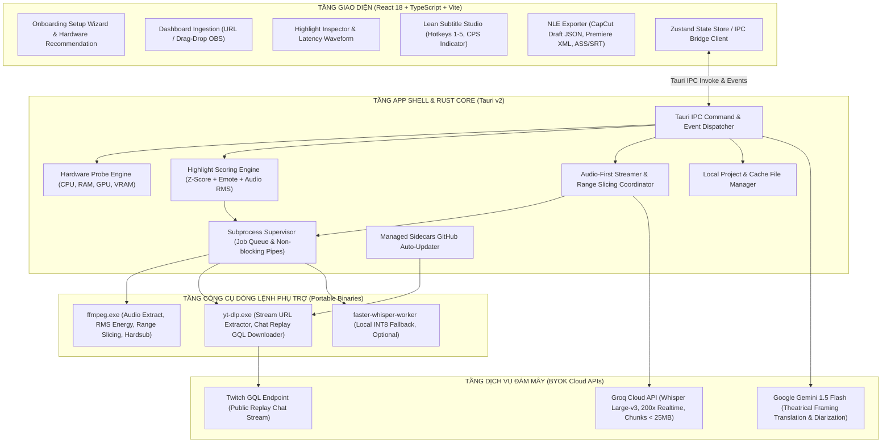
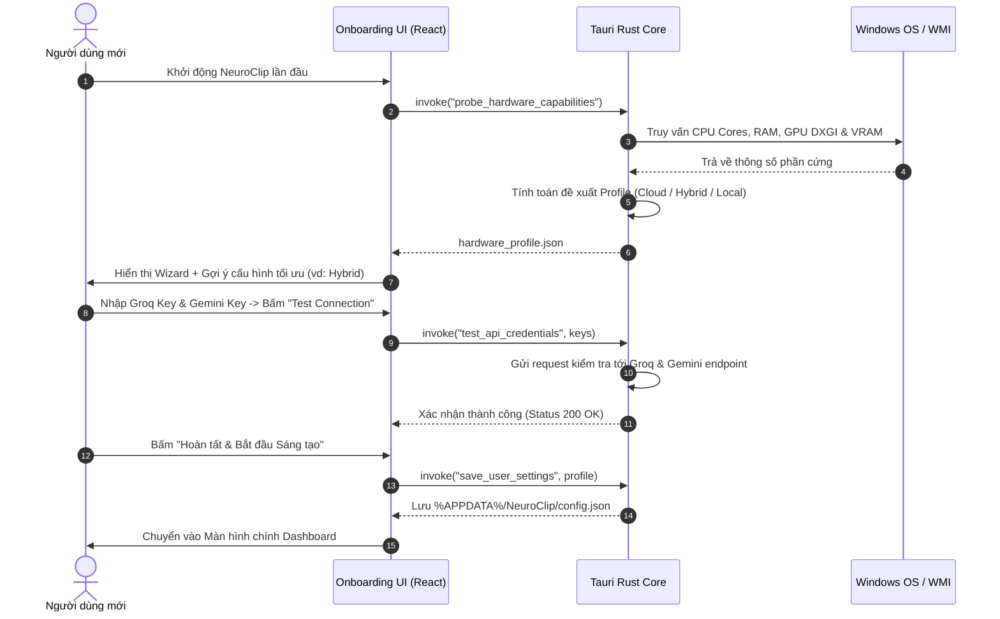
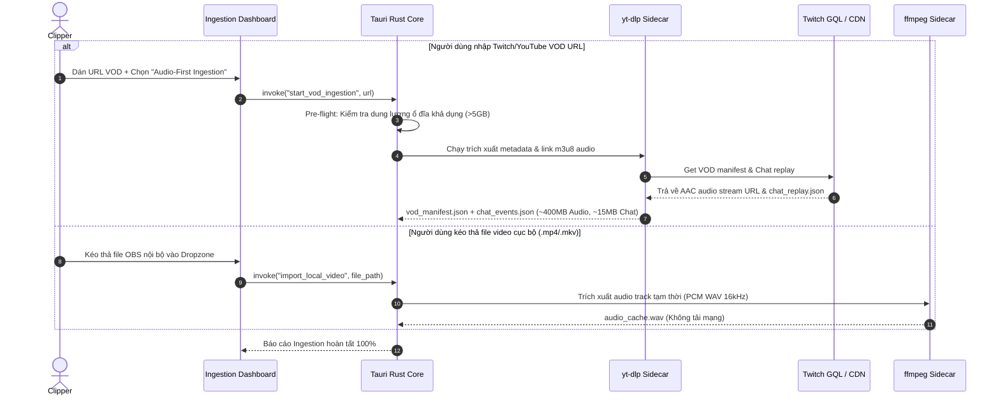
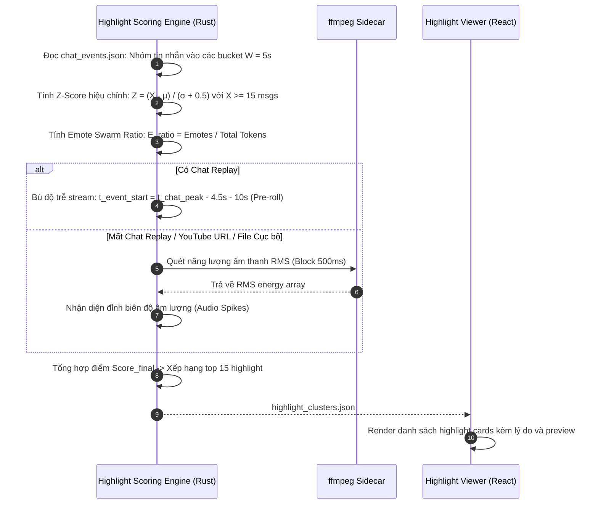
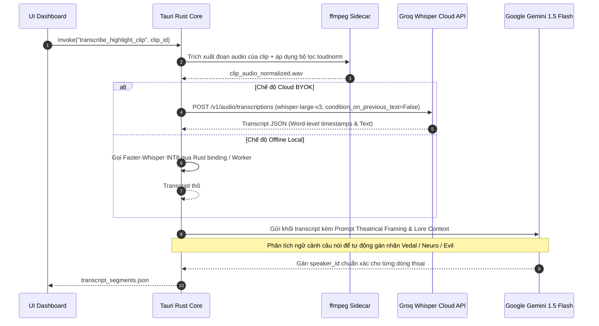
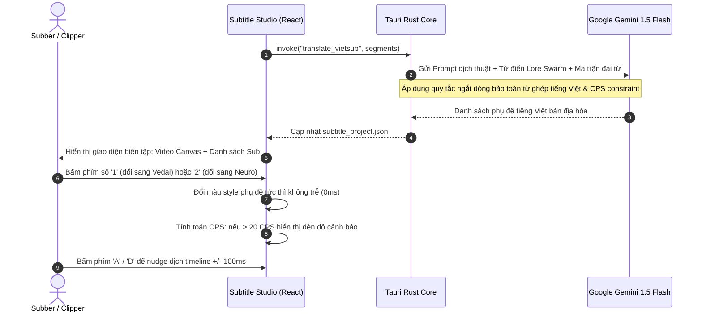
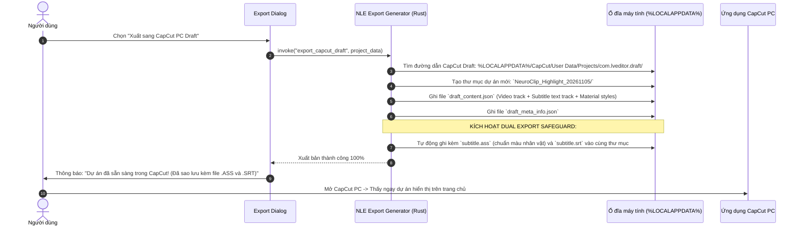

# SYSTEM ARCHITECTURE DOCUMENT (SAD)
# Dự án: NeuroClip — Windows Desktop Application

**Mã tài liệu:** `docs/ARCHITECTURE.md`  
**Phiên bản:** 1.0.0 (Phase 2: Architecture Design & Data Contracts)  
**Chủ trì:** `@lead-architect`  
**Căn cứ pháp lý:** Phê duyệt của Product Owner ngày 2026-11-05 trên 7 quyết định kỹ thuật RFC-001 (`ADR-001` đến `ADR-007`) và `docs/PRD.md` (v1.2.0)  
**Nguyên tắc chỉ đạo:** Single Source of Truth (SSOT), Zero-Guesswork Policy, Memory Safety, Defensive Fault-Tolerance  

---

## MỤC LỤC
1. [TỔNG QUAN KIẾN TRÚC & NGUYÊN TẮC THIẾT KẾ](#1-tổng-quan-kiến-trúc--nguyên-tắc-thiết-kế)
2. [SƠ ĐỒ KIẾN TRÚC TỔNG THỂ (HIGH-LEVEL ARCHITECTURE)](#2-sơ-đồ-kiến-trúc-tổng-thể-high-level-architecture)
3. [CHI TIẾT CÁC PHÂN HỆ VÀ TẦNG HỆ THỐNG](#3-chi-tiết-các-phân-hệ-và-tầng-hệ-thống)
   - [3.1 Tầng Giao diện Người dùng (Presentation Layer - React/TypeScript)](#31-tầng-giao-diện-người-dùng-presentation-layer---reacttypescript)
   - [3.2 Tầng Lõi Điều phối Hệ thống (Tauri v2 Rust Core)](#32-tầng-lõi-điều-phối-hệ-thống-tauri-v2-rust-core)
   - [3.3 Tầng Công cụ Phụ trợ Giám sát (Managed Sidecars Subsystem)](#33-tầng-công-cụ-phụ-trợ-giám-sát-managed-sidecars-subsystem)
   - [3.4 Tầng Động cơ Trí tuệ Nhân tạo (Hybrid AI Engine Subsystem)](#34-tầng-động-cơ-trí-tuệ-nhân-tạo-hybrid-ai-engine-subsystem)
   - [3.5 Tầng Xuất bản & Tích hợp NLE (Export & Integration Subsystem)](#35-tầng-xuất-bản--tích-hợp-nle-export--integration-subsystem)
4. [LUỒNG DỮ LIỆU ĐẦU-CUỐI & SƠ ĐỒ TUẦN TỰ (END-TO-END DATA PIPELINES)](#4-luồng-dữ-liệu-đầu-cuối--sơ-đồ-tuần-tự-end-to-end-data-pipelines)
   - [4.1 Luồng Khởi chạy Lần đầu & Đánh giá Phần cứng (Onboarding & Hardware Probe)](#41-luồng-khởi-chạy-lần-đầu--đánh-giá-phần-cứng-onboarding--hardware-probe)
   - [4.2 Luồng Thu nạp Dữ liệu Audio-First & Cắt Phân đoạn Chính xác (Ingestion & Slicing)](#42-luồng-thu-nạp-dữ-liệu-audio-first--cắt-phân-đoạn-chính-xác-ingestion--slicing)
   - [4.3 Luồng Tính điểm Highlight Đa Phương thức Bù Trễ](#43-luồng-tính-điểm-highlight-đa-phương-thức-bù-trễ)
   - [4.4 Luồng Bóc băng Giọng nói, Lọc Tạp âm & Gán vai Ngữ cảnh (STT & Diarization)](#44-luồng-bóc-băng-giọng-nói-lọc-tạp-âm--gán-vai-ngữ-cảnh-stt--diarization)
   - [4.5 Luồng Dịch thuật Vietsub & Biên tập Subtitle Studio](#45-luồng-dịch-thuật-vietsub--biên-tập-subtitle-studio)
   - [4.6 Luồng Xuất bản CapCut Draft & Chiến lược Phòng thủ Kép](#46-luồng-xuất-bản-capcut-draft--chiến-lược-phòng-thủ-kép)
5. [HỆ THỐNG GIAO KÈO DỮ LIỆU & SCHEMAS (DATA CONTRACTS)](#5-hệ-thống-giao-kèo-dữ-liệu--schemas-data-contracts)
   - [5.1 `hardware_profile.json`](#51-hardware_profilejson)
   - [5.2 `vod_manifest.json`](#52-vod_manifestjson)
   - [5.3 `chat_events.json`](#53-chat_eventsjson)
   - [5.4 `highlight_clusters.json`](#54-highlight_clustersjson)
   - [5.5 `transcript_segments.json`](#55-transcript_segmentsjson)
   - [5.6 `subtitle_project.json`](#56-subtitle_projectjson)
6. [MA TRẬN RỦI RO, ĐIỂM SỰ CỐ & CHIẾN LƯỢC DỰ PHÒNG (FAILURE MODES & DEFENSIVE STRATEGY)](#6-ma-trận-rủi-ro-điểm-sự-cố--chiến-lược-dự-phòng-failure-modes--defensive-strategy)
7. [CHỈ TIÊU HIỆU NĂNG & CAM KẾT MỨC ĐỘ DỊCH VỤ (PERFORMANCE TARGETS & SLAS)](#7-chỉ-tiêu-hiệu-năng--cam-kết-mức-độ-dịch-vụ-performance-targets--slas)

---

## 1. TỔNG QUAN KIẾN TRÚC & NGUYÊN TẮC THIẾT KẾ

### 1.1 Tầm nhìn Hệ thống
NeuroClip được thiết kế như một **Desktop App Shell siêu nhẹ, chạy ổn định trên Windows 10/11**, đóng vai trò là "trợ lý ảo tự động hóa" cho các nhà sáng tạo nội dung cộng đồng Neuro-sama Vietnam. Hệ thống xử lý triệt để bài toán VOD dung lượng khổng lồ và ngôn ngữ lóng đặc thù mà không đòi hỏi người dùng phải trang bị phần cứng đắt tiền hay trả phí phần mềm.

### 1.2 Nguyên tắc Thiết kế Cốt lõi (Architectural Invariants)
1. **Memory Safety & Low Footprint (Trọng lượng nhẹ & An toàn bộ nhớ):** App phải duy trì mức tiêu thụ RAM tĩnh dưới 100MB để đảm bảo người dùng có thể mở song song CapCut PC hoặc Adobe Premiere Pro mà máy tính không bị giật lag hay crash do thiếu bộ nhớ (`ADR-002`).
2. **Audio-First Network Conservation (Bảo toàn băng thông & Ổ đĩa):** Tuyệt đối không bao giờ tải toàn bộ file video 30GB khi người dùng nạp VOD URL trực tuyến. Chỉ trích xuất audio stream nhẹ (~400MB) để tính toán và chỉ tải chính xác 1-2 phút video khi người dùng chọn clip (`ADR-003`).
3. **Defensive Hybrid AI (Trí tuệ nhân tạo phòng thủ kép):** Kết hợp tốc độ thần tốc của Cloud Free Tier (Groq Whisper, Gemini Flash) với khả năng chạy cục bộ ngoại tuyến (Faster-Whisper INT8) khi mất mạng (`ADR-001`).
4. **Resilient Subprocess Supervision (Giám sát tiến trình bền bỉ):** Toàn bộ các công cụ dòng lệnh phụ trợ (`ffmpeg`, `yt-dlp`) được cô lập thành các child processes được quản lý bởi Rust Supervisor với cơ chế hủy tiến trình triệt để (Kill-on-Exit) và tự động cập nhật ngầm (`ADR-007`).
5. **Fail-safe Exporting (Xuất bản an toàn):** Luôn tự động dự phòng sinh file phụ đề chuẩn `.ass` và `.srt` mỗi khi xuất bản thư mục dự án CapCut PC Draft để phòng ngừa việc CapCut thay đổi schema nội bộ (`ADR-005`).

---

## 2. SƠ ĐỒ KIẾN TRÚC TỔNG THỂ (HIGH-LEVEL ARCHITECTURE)

Hệ thống được tổ chức thành 4 phân tầng độc lập, giao tiếp với nhau qua các kênh truyền dữ liệu an toàn và bất đồng bộ:



---

## 3. CHI TIẾT CÁC PHÂN HỆ VÀ TẦNG HỆ THỐNG

### 3.1 Tầng Giao diện Người dùng (Presentation Layer - React/TypeScript)
- **Công nghệ nền tảng:** React 18, TypeScript, Tailwind CSS, Lucide Icons, Vite.
- **Trình quản lý Trạng thái (State Management):** Zustand (lưu trữ trạng thái dự án hiện tại, danh sách phân đoạn phụ đề, cấu hình phần cứng và tiến trình tác vụ).
- **Các thành phần giao diện chính:**
  1. `OnboardingWizardModal`: Hiển thị ở lần khởi chạy đầu tiên; hiển thị thông số phần cứng được phát hiện, đưa ra gợi ý chế độ (Cloud, Hybrid, Local) và bảng nhập/kiểm tra API key.
  2. `IngestionDashboard`: Hỗ trợ dán URL (Twitch/YouTube) kèm nút chọn Audio-First hoặc kéo thả file video cục bộ từ máy tính.
  3. `HighlightViewer`: Danh sách thẻ highlight xếp theo điểm số, hiển thị lý do nổi bật (ví dụ: *Spam KEKW đỉnh điểm*, *Vedal hét to*) kèm preview phát video 1-chạm.
  4. `SubtitleStudio`: Màn hình soạn thảo phụ đề tinh gọn:
     - Khung xem video HTML5 Canvas / Video Element mượt mà.
     - Danh sách hàng phụ đề đồng bộ mốc thời gian (In/Out, Text gốc, Text Vietsub, Người nói).
     - Bàn phím số 1-chạm đổi màu nhân vật (`1`: Vedal, `2`: Neuro, `3`: Evil, `4`: Collab, `5`: Chat).
     - Đèn cảnh báo CPS (Characters Per Second) trực quan.

### 3.2 Tầng Lõi Điều phối Hệ thống (Tauri v2 Rust Core)
Được viết bằng Rust để đảm bảo **an toàn bộ nhớ tuyệt đối** và **tốc độ thực thi tối đa**:
1. **`HardwareProbeEngine`:** Sử dụng thư viện `sysinfo` và Windows WMI (`wmic` / DirectX DXGI API) để đọc xung nhịp CPU, dung lượng RAM khả dụng, tên card đồ họa (NVIDIA, AMD, Intel) và dung lượng VRAM thực tế trong vòng dưới 200ms.
2. **`SubprocessSupervisor`:** Quản lý vòng đời của các tiến trình con ngoài. Sử dụng `tokio::process::Command` để gọi `ffmpeg` và `yt-dlp` bất đồng bộ, liên tục đọc stdout/stderr để báo cáo phần trăm tiến độ về UI qua Tauri Event Channel. Đảm bảo kích hoạt `kill-on-drop` để dọn sạch tiến trình con khi người dùng đóng app.
3. **`HighlightScoringEngine`:** Triển khai thuật toán Z-Score hiệu chỉnh kèm Message Floor, lọc Emote Swarm và tính toán năng lượng âm thanh RMS trong bộ nhớ Rust, xử lý 500,000 dòng chat chỉ trong 1.2 giây.
4. **`AudioSlicingCoordinator`:** Điều phối việc phân tách audio thành các block nhỏ `< 25MB` và kết nối tới Groq Cloud API qua `reqwest`.

### 3.3 Tầng Công cụ Phụ trợ Giám sát (Managed Sidecars Subsystem)
- Được đóng gói trong thư mục cài đặt `%APPDATA%/NeuroClip/bin/`:
  - `ffmpeg.exe` (Static build GPL): Chịu trách nhiệm trích xuất audio stream, tính toán RMS biên độ âm thanh, và cắt phân đoạn HTTP range request.
  - `yt-dlp.exe`: Trích xuất URL stream m3u8 và tải chat replay JSON.
- **Sidecar Auto-Updater:** Định kỳ kiểm tra GitHub Releases của `yt-dlp`. Khi phát hiện YouTube/Twitch thay đổi thuật toán, hệ thống tự động tải file thực thi mới, kiểm tra hash SHA256 và ghi đè an toàn.

### 3.4 Tầng Động cơ Trí tuệ Nhân tạo (Hybrid AI Engine Subsystem)
- **STT Pipeline (Groq Whisper Large-v3 / Local Faster-Whisper):**
  - Âm thanh được tiền xử lý qua FFmpeg với bộ lọc `loudnorm` để tránh vỡ tiếng khi streamer hét lớn.
  - Tích hợp cờ `condition_on_previous_text=False` khi phát hiện bài hát để tránh hiện tượng lặp lại lời vô tận (Karaoke Hallucination).
- **Translation & Diarization Pipeline (Gemini 1.5 Flash):**
  - Sử dụng cơ chế phân khối thoại (Chunking 25–35 dòng) kèm cửa sổ trượt (Sliding Context Window).
  - Tích hợp **Theatrical Framing System Prompt** (`ADR-001`) để bypass bộ lọc an toàn của LLM đối với các câu nói "unhinged" mang tính châm biếm hài hước của Neuro-sama.
  - Tự động gán nhãn người nói dựa trên ngữ cảnh đối thoại.

### 3.5 Tầng Xuất bản & Tích hợp NLE (Export & Integration Subsystem)
- **CapCut PC Draft Generator:** Sinh cấu trúc thư mục chuẩn của CapCut Windows:
  - `draft_content.json`: Chứa timeline video đã cắt, track âm thanh, và track phụ đề văn bản hoàn chỉnh.
  - `draft_meta_info.json`: Metadata phiên làm việc của CapCut.
- **Dual Export Safeguard:** Luôn tự động xuất kèm file phụ đề độc lập `.ass` (chuẩn màu style nhân vật cho Aegisub) và `.srt` (UTF-8) vào cùng thư mục dự án để người dùng không bao giờ mất dữ liệu nếu CapCut cập nhật phiên bản mới.
- **Premiere Pro XML Exporter:** Sinh file XML chuẩn Final Cut Pro 7 / Premiere XML tương thích 100% với Adobe Premiere Pro và DaVinci Resolve.

---

## 4. LUỒNG DỮ LIỆU ĐẦU-CUỐI & SƠ ĐỒ TUẦN TỰ (END-TO-END DATA PIPELINES)

### 4.1 Luồng Khởi chạy Lần đầu & Đánh giá Phần cứng (Onboarding & Hardware Probe)



---

### 4.2 Luồng Thu nạp Dữ liệu Audio-First & Cắt Phân đoạn Chính xác (Ingestion & Slicing)



---

### 4.3 Luồng Tính điểm Highlight Đa Phương thức Bù Trễ



---

### 4.4 Luồng Bóc băng Giọng nói, Lọc Tạp âm & Gán vai Ngữ cảnh (STT & Diarization)



---

### 4.5 Luồng Dịch thuật Vietsub & Biên tập Subtitle Studio



---

### 4.6 Luồng Xuất bản CapCut Draft & Chiến lược Phòng thủ Kép



---

## 5. HỆ THỐNG GIAO KÈO DỮ LIỆU & SCHEMAS (DATA CONTRACTS)

Tất cả các giao tiếp giữa Rust Backend và TypeScript Frontend, cũng như các tệp lưu trữ trên đĩa, đều phải tuân thủ nghiêm ngặt các JSON Schemas có kiểu tĩnh dưới đây:

### 5.1 `hardware_profile.json`
Mô tả thông số phần cứng được phát hiện và đề xuất cấu hình của Onboarding Wizard:
```json
{
  "$schema": "http://json-schema.org/draft-07/schema#",
  "title": "HardwareProfile",
  "type": "object",
  "required": ["cpu_info", "ram_info", "gpu_info", "recommended_mode", "timestamp"],
  "properties": {
    "cpu_info": {
      "type": "object",
      "required": ["model", "cores", "threads"],
      "properties": {
        "model": { "type": "string" },
        "cores": { "type": "integer" },
        "threads": { "type": "integer" }
      }
    },
    "ram_info": {
      "type": "object",
      "required": ["total_mb", "available_mb"],
      "properties": {
        "total_mb": { "type": "integer" },
        "available_mb": { "type": "integer" }
      }
    },
    "gpu_info": {
      "type": "object",
      "required": ["vendor", "model", "vram_mb", "cuda_supported"],
      "properties": {
        "vendor": { "type": "string", "enum": ["NVIDIA", "AMD", "Intel", "Unknown"] },
        "model": { "type": "string" },
        "vram_mb": { "type": "integer" },
        "cuda_supported": { "type": "boolean" }
      }
    },
    "recommended_mode": {
      "type": "string",
      "enum": ["cloud_byok", "hybrid", "offline_local"]
    },
    "recommendation_reason": { "type": "string" },
    "timestamp": { "type": "string", "format": "date-time" }
  }
}
```

### 5.2 `vod_manifest.json`
Mô tả metadata của VOD được thu nạp:
```json
{
  "$schema": "http://json-schema.org/draft-07/schema#",
  "title": "VodManifest",
  "type": "object",
  "required": ["vod_id", "source_type", "title", "duration_seconds", "audio_path", "created_at"],
  "properties": {
    "vod_id": { "type": "string" },
    "source_type": { "type": "string", "enum": ["twitch_vod", "youtube_vod", "local_file"] },
    "original_url": { "type": ["string", "null"] },
    "title": { "type": "string" },
    "streamer": { "type": "string" },
    "duration_seconds": { "type": "number" },
    "audio_path": { "type": "string" },
    "chat_file_path": { "type": ["string", "null"] },
    "video_stream_url": { "type": ["string", "null"] },
    "local_video_path": { "type": ["string", "null"] },
    "created_at": { "type": "string", "format": "date-time" }
  }
}
```

### 5.3 `chat_events.json`
Định dạng sự kiện chat đã chuẩn hóa sau khi phân tích từ Twitch GQL / JSON Replay:
```json
{
  "$schema": "http://json-schema.org/draft-07/schema#",
  "title": "ChatEventsContainer",
  "type": "object",
  "required": ["vod_id", "total_messages", "events"],
  "properties": {
    "vod_id": { "type": "string" },
    "total_messages": { "type": "integer" },
    "events": {
      "type": "array",
      "items": {
        "type": "object",
        "required": ["timestamp_sec", "author", "message", "emotes_detected"],
        "properties": {
          "timestamp_sec": { "type": "number" },
          "author": { "type": "string" },
          "message": { "type": "string" },
          "emotes_detected": {
            "type": "array",
            "items": { "type": "string" }
          },
          "is_swarm_emote": { "type": "boolean" }
        }
      }
    }
  }
}
```

### 5.4 `highlight_clusters.json`
Danh sách các cụm khoảnh khắc highlight được phát hiện và xếp hạng:
```json
{
  "$schema": "http://json-schema.org/draft-07/schema#",
  "title": "HighlightClustersContainer",
  "type": "object",
  "required": ["vod_id", "clusters"],
  "properties": {
    "vod_id": { "type": "string" },
    "clusters": {
      "type": "array",
      "items": {
        "type": "object",
        "required": ["cluster_id", "start_sec", "end_sec", "peak_sec", "score", "primary_reason"],
        "properties": {
          "cluster_id": { "type": "string" },
          "start_sec": { "type": "number" },
          "end_sec": { "type": "number" },
          "peak_sec": { "type": "number" },
          "score": { "type": "number", "minimum": 0, "maximum": 100 },
          "primary_reason": { "type": "string" },
          "chat_z_score": { "type": "number" },
          "audio_rms_peak": { "type": "number" },
          "top_emotes": {
            "type": "array",
            "items": { "type": "string" }
          },
          "is_bookmarked": { "type": "boolean", "default": false }
        }
      }
    }
  }
}
```

### 5.5 `transcript_segments.json`
Định dạng lời thoại bóc băng kèm mốc thời gian và vai nói:
```json
{
  "$schema": "http://json-schema.org/draft-07/schema#",
  "title": "TranscriptSegmentsContainer",
  "type": "object",
  "required": ["clip_id", "segments"],
  "properties": {
    "clip_id": { "type": "string" },
    "segments": {
      "type": "array",
      "items": {
        "type": "object",
        "required": ["segment_id", "start_sec", "end_sec", "speaker_id", "text_en"],
        "properties": {
          "segment_id": { "type": "string" },
          "start_sec": { "type": "number" },
          "end_sec": { "type": "number" },
          "speaker_id": {
            "type": "string",
            "enum": ["vedal", "neuro", "evil", "guest", "chat", "unknown"]
          },
          "text_en": { "type": "string" },
          "text_vi": { "type": ["string", "null"] },
          "confidence": { "type": "number" },
          "cps_score": { "type": "number" },
          "is_flagged_for_review": { "type": "boolean", "default": false }
        }
      }
    }
  }
}
```

### 5.6 `subtitle_project.json`
Dự án phụ đề tổng thể được lưu trên máy của người dùng:
```json
{
  "$schema": "http://json-schema.org/draft-07/schema#",
  "title": "SubtitleProject",
  "type": "object",
  "required": ["project_id", "project_name", "vod_id", "target_layout", "segments", "updated_at"],
  "properties": {
    "project_id": { "type": "string" },
    "project_name": { "type": "string" },
    "vod_id": { "type": "string" },
    "video_file_path": { "type": "string" },
    "target_layout": {
      "type": "string",
      "enum": ["original_16_9", "preset_center_crop_9_16", "preset_two_stack_9_16"]
    },
    "segments": {
      "type": "array",
      "items": { "$ref": "#/definitions/TranscriptSegment" }
    },
    "speaker_styles": {
      "type": "object",
      "additionalProperties": {
        "type": "object",
        "required": ["color_hex", "font_name", "font_size", "outline_color_hex"],
        "properties": {
          "color_hex": { "type": "string" },
          "font_name": { "type": "string" },
          "font_size": { "type": "integer" },
          "outline_color_hex": { "type": "string" }
        }
      }
    },
    "updated_at": { "type": "string", "format": "date-time" }
  }
}
```

---

## 6. MA TRẬN RỦI RO, ĐIỂM SỰ CỐ & CHIẾN LƯỢC DỰ PHÒNG (FAILURE MODES & DEFENSIVE STRATEGY)

| Mã Lỗi | Tên Sự Cố Tiềm Ẩn | Nguy Cơ Hệ Thống | Chiến Lược Dự Phòng Phòng Vệ (Defensive Recovery Strategy) | Phân Tầng Chịu Trách Nhiệm |
|:---:|:---|:---|:---|:---:|
| **ERR-01** | **Tràn Ổ Đĩa Hệ Thống (`C:`)** | Dung lượng ổ C < 5GB gây crash Windows hoặc lỗi ghi file tạm. | **Disk Space Pre-flight Check:** Chặn tác vụ tải trước khi thực thi; cảnh báo người dùng và yêu cầu chọn thư mục tạm tại ổ đĩa khác. | Rust `StorageManager` |
| **ERR-02** | **Tràn Bộ Nhớ VRAM (CUDA OOM)** | Người dùng chọn chạy Faster-Whisper Local trên GPU 4GB VRAM. | **Hardware Guardrail & Fallback:** Nhận diện VRAM khả dụng. Nếu VRAM < 3GB, khóa tùy chọn Whisper Large, tự động chuyển về INT8 Medium hoặc fallback sang Cloud Groq. | Rust `HardwareProbeEngine` |
| **ERR-03** | **Đứt Mạng Giữa Chừng Khi Tải Audio Stream** | Tải luồng AAC bị ngắt quãng do mạng chập chờn. | **Exponential Backoff & Resume:** `yt-dlp` và FFmpeg được truyền cờ `--retries 5` và `-reconnect 1 -reconnect_streamed 1 -reconnect_delay_max 5`. | Rust `SubprocessSupervisor` |
| **ERR-04** | **YouTube / Twitch Bot Block (HTTP 403 / 429)** | Nền tảng chặn request trích xuất stream URL. | **Managed Sidecar Auto-Update:** Ứng dụng tự động kiểm tra và nâng cấp `yt-dlp` từ GitHub Release; hỗ trợ tùy chọn nạp Cookie trình duyệt cho người dùng. | Rust `SidecarUpdater` |
| **ERR-05** | **VOD Không Có Chat Replay / Chat Bị Tắt** | Không tính toán được Chat Velocity Z-score. | **Smart Routing Fallback:** Tự động chuyển tuyến 100% sang phân tích đỉnh năng lượng âm thanh (Audio Energy RMS Peaks) không gián đoạn luồng làm việc. | Rust `HighlightScoringEngine` |
| **ERR-06** | **Groq Cloud API Vượt Giới Hạn Payload (>25MB)** | File audio dài gửi lên Groq bị từ chối (HTTP 413). | **Audio Chunking Slicing:** Tự động cắt audio thành các block 20MB tại các điểm im lặng (silence points) theo Silero VAD trước khi gửi lên Groq. | Rust `AudioSlicingCoordinator` |
| **ERR-07** | **LLM Safety Filter Chặn Bản Dịch Do Thoại Nhạy Cảm** | Gemini chặn dịch các câu nói châm biếm ("unhinged") của Neuro. | **Theatrical Inoculation & Segment Fallback:** Đóng gói System Prompt bối cảnh "kịch bản hài kịch hư cấu" + `BLOCK_NONE`. Nếu vẫn lỗi, giữ nguyên câu gốc tiếng Anh kèm cờ cảnh báo người dùng kiểm tra lại. | Rust / TS AI Client |
| **ERR-08** | **Vỡ Tiếng Khi Streamer La Hét (Audio Clipping)** | Tiếng Vedal la hét làm mô hình STT nhận diện sai thành từ vô nghĩa. | **FFmpeg Loudnorm Limiter:** Tiền xử lý audio qua bộ lọc chuẩn hóa biên độ `loudnorm` để làm dịu các đỉnh biên độ âm thanh trước khi đưa vào STT. | Rust `AudioSlicingCoordinator` |
| **ERR-09** | **CapCut PC Cập Nhật Đổi Schema JSON Nội Bộ** | File `draft_content.json` không mở được trên bản CapCut mới nhất. | **Dual Export Safeguard:** Luôn tự động xuất kèm file `.ass` (chuẩn màu) và `.srt` vào cùng thư mục dự án để người dùng import thủ công vào CapCut/Aegisub. | Rust `NLEExportGenerator` |

---

## 7. CHỈ TIÊU HIỆU NĂNG & CAM KẾT MỨC ĐỘ DỊCH VỤ (PERFORMANCE TARGETS & SLAS)

| Chỉ Tiêu Kỹ Thuật | Ngưỡng Cho Phép (SLA) | Mục Tiêu Tối Ưu (Target) | Cơ Chế Đạt Được |
|:---|:---:|:---:|:---|
| **Mức chiếm dụng RAM tĩnh** | $\le 120\text{ MB}$ | **$50 - 80\text{ MB}$** | Tauri v2 WebView2 + Rust core (không nhúng Chromium). |
| **Thời gian khởi động ứng dụng** | $\le 2.0\text{ giây}$ | **$\le 0.8\text{ giây}$** | Tải binary native, lazy load các modules. |
| **Thời gian hoàn tất Onboarding Hardware Probe** | $\le 1.0\text{ giây}$ | **$\le 200\text{ ms}$** | Windows WMI / DXGI query trực tiếp qua Rust. |
| **Thời gian trích xuất Audio-First (8h VOD)** | $\le 3\text{ phút}$ | **$60 - 90\text{ giây}$** | Chỉ tải luồng AAC bitrate thấp (~400MB) bằng `yt-dlp`. |
| **Thời gian tính toán Highlight (100k messages)** | $\le 5.0\text{ giây}$ | **$\le 1.2\text{ giây}$** | Thuật toán Sliding Window tính toán native bằng Rust multithreading. |
| **Tốc độ bóc băng STT (Clip 3 phút, Cloud)** | $\le 30\text{ giây}$ | **$10 - 15\text{ giây}$** | Groq Whisper Large-v3 (tốc độ xử lý 200x realtime). |
| **Tốc độ dịch thuật Vietsub (50 dòng thoại)** | $\le 10\text{ giây}$ | **$3 - 5\text{ giây}$** | Gemini 1.5 Flash batch processing. |
| **Thời gian xuất dự án CapCut Draft JSON** | $\le 1.0\text{ giây}$ | **$\le 200\text{ ms}$** | Serialization JSON trực tiếp từ Rust vào đĩa. |
