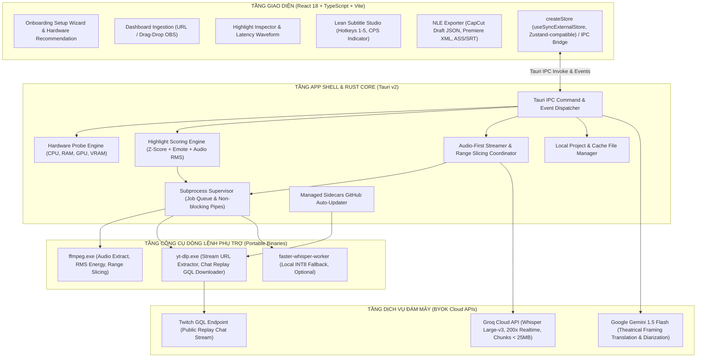
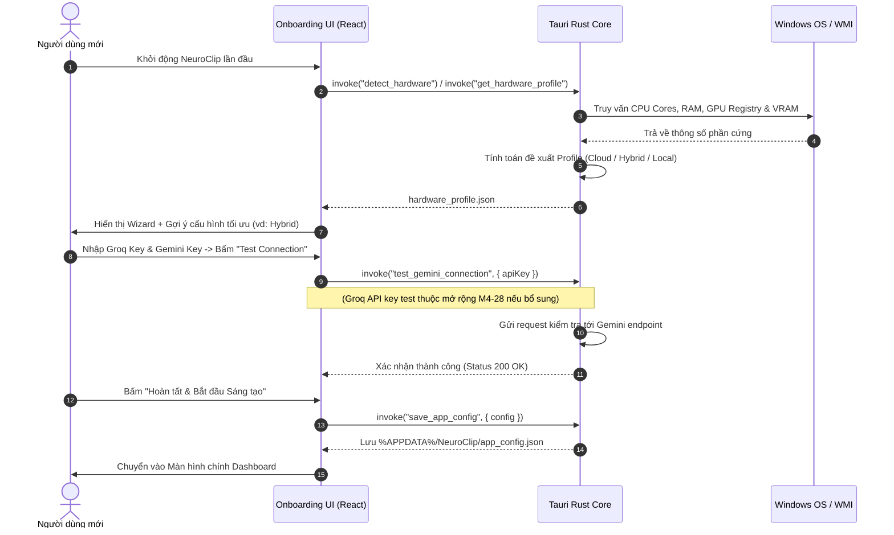
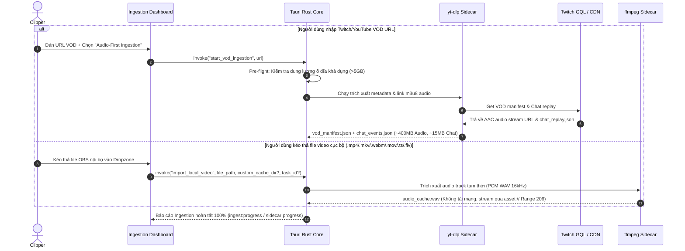
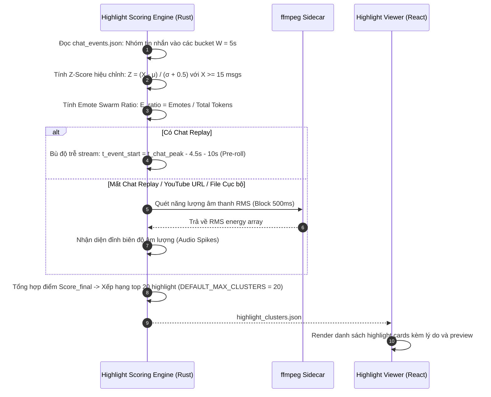
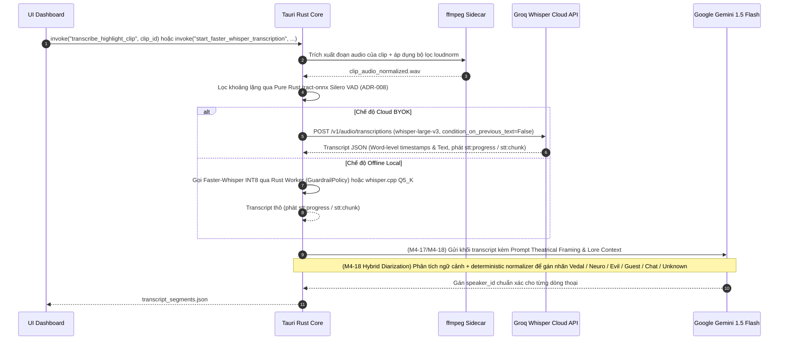
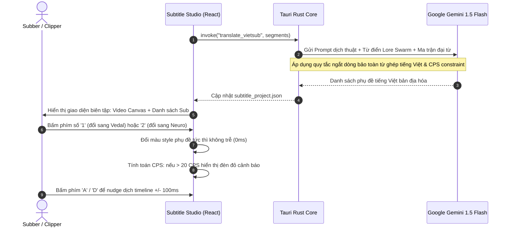
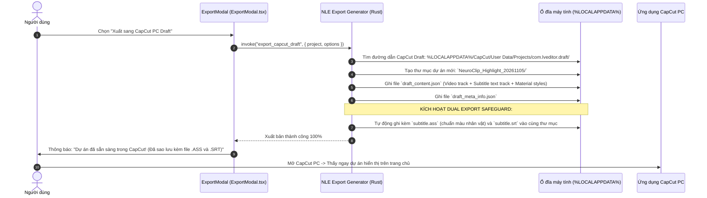

# SYSTEM ARCHITECTURE DOCUMENT (SAD)
# Dự án: NeuroClip — Windows Desktop Application

**Mã tài liệu:** `docs/ARCHITECTURE.md`  
**Phiên bản:** 1.0.0 (Phase 2: Architecture Design & Data Contracts — Đã đồng bộ Phase 4 `M4-01..M4-26`)  
**Chủ trì:** `@lead-architect`  
**Căn cứ pháp lý:** Phê duyệt của Product Owner ngày 2026-11-05 trên 7 quyết định kỹ thuật RFC-001 (`ADR-001` đến `ADR-007`), phê duyệt ngày 2026-11-16 cho Pure Rust `tract-onnx` Silero VAD (`RFC-002` $\rightarrow$ `ADR-008`), và `docs/PRD.md` (v1.3.0)  
**Nguyên tắc chỉ đạo:** Single Source of Truth (SSOT), Zero-Guesswork Policy, Memory Safety, Defensive Fault-Tolerance  

---

## MỤC LỤC
1. [TỔNG QUAN KIẾN TRÚC & NGUYÊN TẮC THIẾT KẾ](#1-tổng-quan-kiến-trúc--nguyên-tắc-thiết-kế)
2. [SƠ ĐỒ KIẾN TRÚC TỔNG THỂ (HIGH-LEVEL ARCHITECTURE)](#2-sơ-đồ-kiến-trúc-tổng-thể-high-level-architecture)
3. [CHI TIẾT CÁC PHÂN HỆ VÀ TẦNG HỆ THỐNG](#3-chi-tiết-các-phân-hệ-và-tầng-hệ-thống)
   - [3.1 Tầng Giao diện Người dùng (Presentation Layer - React/TypeScript)](#31-tầng-giao-diện-người-dùng-presentation-layer---reacttypescript)
   - [3.2 Tầng Lõi Điều phối Hệ thống (Tauri v2 Rust Core)](#32-tầng-lõi-điều-phối-hệ-thống-tauri-v2-rust-core)
   - [3.3 Tầng Công cụ Phụ trợ Giám sát (Managed Sidecars Subsystem)](#33-tầng-công-cụ-phụ-trợ-giám-sát-managed-sidecars-subsystem)
   - [3.4 Tầng Động cơ Trí tuệ Nhân tạo (Hybrid AI Engine Subsystem)](#34-tầng-động-cơ-trí-tuệ-nhân-tạo-hybrid-ai-engine-subsystem)
   - [3.5 Tầng Xuất bản & Tích hợp NLE (Export & Integration Subsystem)](#35-tầng-xuất-bản--tích-hợp-nle-export--integration-subsystem)
4. [LUỒNG DỮ LIỆU ĐẦU-CUỐI & SƠ ĐỒ TUẦN TỰ (END-TO-END DATA PIPELINES)](#4-luồng-dữ-liệu-đầu-cuối--sơ-đồ-tuần-tự-end-to-end-data-pipelines)
   - [4.1 Luồng Khởi chạy Lần đầu & Đánh giá Phần cứng (Onboarding & Hardware Probe)](#41-luồng-khởi-chạy-lần-đầu--đánh-giá-phần-cứng-onboarding--hardware-probe)
   - [4.2 Luồng Thu nạp Dữ liệu Audio-First & Cắt Phân đoạn Chính xác (Ingestion & Slicing)](#42-luồng-thu-nạp-dữ-liệu-audio-first--cắt-phân-đoạn-chính-xác-ingestion--slicing)
   - [4.3 Luồng Tính điểm Highlight Đa Phương thức Bù Trễ](#43-luồng-tính-điểm-highlight-đa-phương-thức-bù-trễ)
   - [4.4 Luồng Bóc băng Giọng nói, Lọc Tạp âm & Gán vai Ngữ cảnh (STT & Diarization)](#44-luồng-bóc-băng-giọng-nói-lọc-tạp-âm--gán-vai-ngữ-cảnh-stt--diarization)
   - [4.5 Luồng Dịch thuật Vietsub & Biên tập Subtitle Studio](#45-luồng-dịch-thuật-vietsub--biên-tập-subtitle-studio)
   - [4.6 Luồng Xuất bản CapCut Draft & Chiến lược Phòng thủ Kép](#46-luồng-xuất-bản-capcut-draft--chiến-lược-phòng-thủ-kép)
5. [HỆ THỐNG GIAO KÈO DỮ LIỆU & SCHEMAS (DATA CONTRACTS)](#5-hệ-thống-giao-kèo-dữ-liệu--schemas-data-contracts)
   - [5.1 `hardware_profile.json`](#51-hardware_profilejson)
   - [5.2 `vod_manifest.json`](#52-vod_manifestjson)
   - [5.3 `chat_events.json`](#53-chat_eventsjson)
   - [5.4 `highlight_clusters.json`](#54-highlight_clustersjson)
   - [5.5 `transcript_segments.json`](#55-transcript_segmentsjson)
   - [5.6 `subtitle_project.json`](#56-subtitle_projectjson)
6. [MA TRẬN RỦI RO, ĐIỂM SỰ CỐ & CHIẾN LƯỢC DỰ PHÒNG (FAILURE MODES & DEFENSIVE STRATEGY)](#6-ma-trận-rủi-ro-điểm-sự-cố--chiến-lược-dự-phòng-failure-modes--defensive-strategy)
7. [CHỈ TIÊU HIỆU NĂNG & CAM KẾT MỨC ĐỘ DỊCH VỤ (PERFORMANCE TARGETS & SLAS)](#7-chỉ-tiêu-hiệu-năng--cam-kết-mức-độ-dịch-vụ-performance-targets--slas)

---

## 1. TỔNG QUAN KIẾN TRÚC & NGUYÊN TẮC THIẾT KẾ

### 1.1 Tầm nhìn Hệ thống
NeuroClip được thiết kế như một **Desktop App Shell siêu nhẹ, chạy ổn định trên Windows 10/11**, đóng vai trò là "trợ lý ảo tự động hóa" cho các nhà sáng tạo nội dung cộng đồng Neuro-sama Vietnam. Hệ thống xử lý triệt để bài toán VOD dung lượng khổng lồ và ngôn ngữ lóng đặc thù mà không đòi hỏi người dùng phải trang bị phần cứng đắt tiền hay trả phí phần mềm.

### 1.2 Nguyên tắc Thiết kế Cốt lõi (Architectural Invariants)
1. **Memory Safety & Low Footprint (Trọng lượng nhẹ & An toàn bộ nhớ):** App phải duy trì mức tiêu thụ RAM tĩnh dưới 100MB để đảm bảo người dùng có thể mở song song CapCut PC hoặc Adobe Premiere Pro mà máy tính không bị giật lag hay crash do thiếu bộ nhớ (`ADR-002`).
2. **Audio-First Network Conservation (Bảo toàn băng thông & Ổ đĩa):** Tuyệt đối không bao giờ tải toàn bộ file video 30GB khi người dùng nạp VOD URL trực tuyến. Chỉ trích xuất audio stream nhẹ (~400MB) để tính toán và chỉ tải chính xác 1-2 phút video khi người dùng chọn clip (`ADR-003`).
3. **Defensive Hybrid AI (Trí tuệ nhân tạo phòng thủ kép):** Kết hợp tốc độ thần tốc của Cloud Free Tier (Groq Whisper, Gemini Flash) với khả năng chạy cục bộ ngoại tuyến (Faster-Whisper INT8) khi mất mạng (`ADR-001`).
4. **Resilient Subprocess Supervision (Giám sát tiến trình bền bỉ):** Toàn bộ các công cụ dòng lệnh phụ trợ (`ffmpeg`, `yt-dlp`) được cô lập thành các child processes được quản lý bởi Rust Supervisor với cơ chế hủy tiến trình triệt để (Kill-on-Exit) và tự động cập nhật ngầm (`ADR-007`).
5. **Fail-safe Exporting (Xuất bản an toàn):** Luôn tự động dự phòng sinh file phụ đề chuẩn `.ass` và `.srt` mỗi khi xuất bản thư mục dự án CapCut PC Draft để phòng ngừa việc CapCut thay đổi schema nội bộ (`ADR-005`).

---

## 2. SƠ ĐỒ KIẾN TRÚC TỔNG THỂ (HIGH-LEVEL ARCHITECTURE)

Hệ thống được tổ chức thành 4 phân tầng độc lập, giao tiếp với nhau qua các kênh truyền dữ liệu an toàn và bất đồng bộ:



---

## 3. CHI TIẾT CÁC PHÂN HỆ VÀ TẦNG HỆ THỐNG

### 3.1 Tầng Giao diện Người dùng (Presentation Layer - React/TypeScript)
- **Công nghệ nền tảng:** React 18.3, TypeScript 5.6 (Strict Mode, zero-any), Tailwind CSS 3.4, Lucide Icons, Vite 5.4.
- **Trình quản lý Trạng thái (State Management):** Toàn bộ 8 store hiện tại (`settingsStore.ts`, `useProjectStore.ts`, `useIngestionStore.ts`, `useChatStore.ts`, `useHighlightStore.ts`, `useTranscriptStore.ts`, `useLogStore.ts`, `useStudioStore.ts`) được xây dựng trên **`src/stores/createStore.ts`** (`React.useSyncExternalStore`) với **API tương thích Zustand** (`createStore`, `create`, `getState`, `getInitialState`, `setState`, `subscribe`, memoized selector + `equalityFn`). Các task `M4-20..M4-26` chạy ổn định trực tiếp trên `createStore.ts` (không cài gói `zustand` rời); `useHardwareStore.ts` thuộc `Target M4-27`.
- **Hiện trạng Shell & Lộ trình thành phần giao diện:**
  - `main.tsx` bọc `<App />` trong `<GlobalErrorBoundary>`; `App.tsx` hiện tại render Acrylic Dark Theme cùng shell 4 tab tối giản (`overview`, `ingestion` gắn `IngestionDashboard` + `DropZone`, `highlights` gắn `HighlightViewer`, `studio` gắn `SubtitleStudio`) không gọi IPC lúc mount.
  - Các thành phần UI trọng tâm Phase 4 (`M4-06..M4-28`):
    1. `OnboardingWizardModal` *(Target `M4-28`)* & `HardwareRecommendation` *(Target `M4-27`)*: Hiển thị ở lần khởi chạy đầu tiên; đề xuất chế độ (Cloud, Hybrid, Local) và bảng nhập/kiểm tra API key.
    2. `IngestionDashboard` & `DropZone` *(đã triển khai tại `M4-06`/`M4-07`)*: Hỗ trợ dán URL (Twitch/YouTube) kèm Audio-First hoặc kéo thả file video cục bộ.
    3. `HighlightViewer` *(đã triển khai tại `M4-12`)*: Danh sách thẻ highlight xếp theo điểm số, lý do nổi bật và bookmark *(nối end-to-end với `sliceVideoSegment` $\rightarrow$ `useStudioStore` tại `TASK-M4-29B`)*.
    4. `SubtitleStudio` *(đã triển khai tại `M4-20..M4-23`, nối `ExportModal` tại `M4-25`)*: Trình soạn thảo phụ đề tinh gọn với HTML5 Video/`asset://` canvas, danh sách ảo hóa custom `useVirtualizer`, bàn phím số 1-chạm đổi màu theo chuẩn **PO Option 1** (`1`: Vedal `#98FB98`, `2`: Neuro `#FFB6C1`, `3`: Evil `#FF0055`, `4`: Guest `#FFD700`, `5`: Chat `#87CEEB`), và đèn cảnh báo CPS.
    5. `ExportModal` *(đã triển khai tại `M4-25..M4-26`, `src/components/export/ExportModal.tsx`)*: Giao diện xuất **CapCut PC Draft JSON** (kèm Dual Export `.ass`/`.srt`), **Premiere Pro XML / FCP7 XML (`<xmeml version="4">`)** kèm export progress bar (`export:progress`), `.ass` (UTF-8 with BOM), và `.srt` (UTF-8 with BOM).

### 3.2 Tầng Lõi Điều phối Hệ thống (Tauri v2 Rust Core)
Được viết bằng Rust để đảm bảo **an toàn bộ nhớ tuyệt đối** và **tốc độ thực thi tối đa**:
1. **`HardwareProbeEngine` (`config/hardware.rs`):** Đọc thông số CPU, RAM khả dụng, tên card đồ họa và dung lượng VRAM thực tế qua Windows Registry (`qwMemorySize`) / Win32 `GlobalMemoryStatusEx` trong vòng dưới 200ms *(phần backend sớm của `M4-27`; UI onboarding thuộc `M4-27/M4-28`)*.
2. **`SubprocessSupervisor` (`sidecar/{mod.rs, supervisor.rs, kill_switch.rs}`):** Quản lý vòng đời các tiến trình con (`ffmpeg`, `yt-dlp`, `whisper.cpp`, `faster-whisper-worker`) qua `tokio::process::Command` với `.kill_on_drop(true)`, Windows Job Objects (`JOB_OBJECT_LIMIT_KILL_ON_JOB_CLOSE`), bounded 1,000-line channels, và event `sidecar:progress`.
3. **`LocalImporter` & `CustomProtocol` (`ingestion/local_importer.rs`, `core/custom_protocol.rs`):** Nạp file video nội bộ (`.mp4`, `.mkv`, `.webm`, `.mov`, `.ts`, `.flv`), trích xuất 16kHz PCM WAV không chạm mạng, và đăng ký giao thức bất đồng bộ `asset://` qua `register_asynchronous_uri_scheme_protocol` hỗ trợ HTTP `206 Partial Content` Range streaming.
4. **`HighlightScoringEngine` (`highlight/*`):** Triển khai thuật toán Z-Score hiệu chỉnh kèm Message Floor (`X >= 15`), lọc Emote Swarm FNV-1a, Audio RMS 500ms, phân cụm NMS và bù độ trễ stream `-4.5s - 10s`.
5. **`AudioSlicingCoordinator` (`ingestion/range_slicer.rs`, `stt/vad_bridge.rs`):** Điều phối HTTP Range slicing (`-ss / -to -c copy`) và cắt audio thành các block `< 20MB` tại khoảng nghỉ tự nhiên để gửi tới Groq Cloud API qua `reqwest`.

### 3.3 Tầng Công cụ Phụ trợ Giám sát (Managed Sidecars Subsystem)
- Dữ liệu dự án, cache và logs lưu tại `%LOCALAPPDATA%/NeuroClip/`; cấu hình `app_config.json` lưu tại `%APPDATA%/NeuroClip/`. Các binary phụ trợ (`ffmpeg.exe`, `yt-dlp.exe`, tùy chọn `whisper.cpp` / `faster-whisper-worker`) được định vị thống nhất qua các lớp fallback: biến môi trường override (`NEUROCLIP_FFMPEG_PATH`, `NEUROCLIP_FFPROBE_PATH`, `NEUROCLIP_YTDLP_PATH`, `NEUROCLIP_*`), `AppConfig.sidecar_paths`, thư mục sidecar cục bộ (`%APPDATA%/NeuroClip/bin/` và `%LOCALAPPDATA%/NeuroClip/bin/`, cùng `%LOCALAPPDATA%/NeuroClip/sidecars/<tool>/` cho local STT workers), thư mục đóng gói `resources/sidecars/`, và `PATH` hệ thống *(lưu ý: `src-tauri/tauri.conf.json` không dùng `externalBin` / `src-tauri/bin/`)*.
  - `ffmpeg.exe` (Static build): Trích xuất audio stream, áp dụng `loudnorm` limiter, tính toán RMS và cắt phân đoạn HTTP range request.
  - `yt-dlp.exe`: Trích xuất URL stream m3u8 và tải chat replay JSON (kèm cookie/UA anti-bot).
- **Sidecar Auto-Updater *(Target `TASK-M4-29`)*:** Định kỳ kiểm tra GitHub Releases của `yt-dlp`, xác thực SHA256 và atomic swap khi YouTube/Twitch thay đổi thuật toán.

### 3.4 Tầng Động cơ Trí tuệ Nhân tạo (Hybrid AI Engine Subsystem)
- **Pure Rust Neural VAD (`ADR-008`, `TASK-M4-14`):** Tích hợp `tract-onnx v0.21` chạy đồ thị tĩnh **Silero VAD v5 16kHz** (`src-tauri/resources/models/silero_vad_16k.onnx`, 1.28MB) bên trong `tokio::task::spawn_blocking`, kèm tầng dự phòng **Pure Rust DSP** (`compute_frame_speech_prob_fallback` trong `stt/vad.rs`) khi lỗi nạp/I/O. Loại bỏ $\ge 90\%$ khoảng lặng/nhạc nền $> 1.5\text{s}$ và xác định điểm cắt chunk `< 20MB` qua `vad_bridge.rs`.
- **STT Pipeline (`TASK-M4-15`, `TASK-M4-16`):**
  - **Cloud BYOK (`stt/groq_client.rs`):** Groq Whisper Large-v3, tiền xử lý FFmpeg `loudnorm=I=-16:TP=-1.5:LRA=11` (`stt/audio_prep.rs`), Karaoke Mode (`condition_on_previous_text=false`), chunk `< 20MB`, phát `stt:progress` camelCase & `stt:chunk`.
  - **Local Offline (`stt/faster_whisper_worker.rs`, `stt/whisper_sidecar.rs`, `stt/model_manager.rs`):** Hỗ trợ `start_faster_whisper_transcription` kèm `GuardrailPolicy` (`"auto_downgrade" | "strict_reject"`, ngưỡng VRAM `< 2500MB`) và xác thực SHA-256 streaming (từ chối file rỗng).
- **Translation & Diarization Pipeline *(Đã triển khai `M4-17..M4-19`)*:**
  - **Core LLM (`M4-17`, `translation/gemini_client.rs`, `prompt_builder.rs`):** Google Gemini 1.5 Flash BYOK, phân khối 25–35 dòng kèm Sliding Context Window, **Theatrical Framing System Prompt**, `safetySettings: BLOCK_NONE`, và Defensive Safety Fallback (`ERR-07`).
  - **Lore, Pronoun & Hybrid Diarization (`M4-18`, `translation/lore_dictionary.rs`, `pronoun_matrix.rs`, `diarization.rs`):** 12 thuật ngữ Swarm Lore (`PRD.md §6.2`), ma trận xưng hô 6 vai chuẩn + hồ sơ collab `cast_members`, và động cơ Hybrid Diarization 3 tầng (LLM context + deterministic normalizer + heuristic fallback).
  - **Smart Line-Wrap & CPS Optimizer (`M4-19`, `translation/line_wrapper.rs`, `cps_optimizer.rs`):** Ngắt dòng bảo toàn từ ghép tiếng Việt ($\le 42$ ký tự 16:9 / $\le 26$ ký tự 9:16), tối ưu Time Borrowing ($\le 800\text{ms}$, khoảng đệm $\ge 50\text{ms}$) và parity với `src/utils/text_wrap.ts`.

### 3.5 Tầng Xuất bản & Tích hợp NLE (Export & Integration Subsystem)
- **CapCut PC Draft Generator *(Đã triển khai `M4-25`: `export/capcut_draft.rs`, `export/capcut_schema.rs`, `commands/export_cmd.rs`)*:** Sinh cấu trúc thư mục chuẩn của CapCut Windows:
  - `draft_content.json`: Chứa timeline video đã cắt, track âm thanh, và track phụ đề văn bản hoàn chỉnh.
  - `draft_meta_info.json`: Metadata phiên làm việc của CapCut.
- **Dual Export Safeguard & `.ASS`/`.SRT` *(Đã triển khai `M4-24..M4-25`: `export/{mod.rs, ass_exporter.rs, srt_exporter.rs}`, facade `stt/subtitle_export.rs`)*:** Luôn tự động xuất kèm file phụ đề độc lập `.ass` (chuẩn màu style nhân vật cho Aegisub, `PlayResX`/`PlayResY` theo `target_layout`, UTF-8 with BOM) và `.srt` (UTF-8 with BOM) vào cùng thư mục dự án để người dùng không bao giờ mất dữ liệu nếu CapCut cập nhật phiên bản mới.
- **Premiere Pro XML Exporter *(Đã triển khai `M4-26`: `export/premiere_xml.rs`, `commands/export_cmd.rs`)*:** Sinh file XML chuẩn Final Cut Pro 7 / Premiere XML (`<xmeml version="4">`) tương thích 100% với Adobe Premiere Pro và DaVinci Resolve, kèm streaming tiến độ `export:progress` về `ExportModal.tsx`.

---

## 4. LUỒNG DỮ LIỆU ĐẦU-CUỐI & SƠ ĐỒ TUẦN TỰ (END-TO-END DATA PIPELINES)

### 4.1 Luồng Khởi chạy Lần đầu & Đánh giá Phần cứng (Onboarding & Hardware Probe)



---

### 4.2 Luồng Thu nạp Dữ liệu Audio-First & Cắt Phân đoạn Chính xác (Ingestion & Slicing)



---

### 4.3 Luồng Tính điểm Highlight Đa Phương thức Bù Trễ



---

### 4.4 Luồng Bóc băng Giọng nói, Lọc Tạp âm & Gán vai Ngữ cảnh (STT & Diarization)



---

### 4.5 Luồng Dịch thuật Vietsub & Biên tập Subtitle Studio



---

### 4.6 Luồng Xuất bản CapCut Draft & Chiến lược Phòng thủ Kép



---

## 5. HỆ THỐNG GIAO KÈO DỮ LIỆU & SCHEMAS (DATA CONTRACTS)

Tất cả các giao tiếp giữa Rust Backend và TypeScript Frontend, cũng như các tệp lưu trữ trên đĩa, đều phải tuân thủ nghiêm ngặt các JSON Schemas có kiểu tĩnh dưới đây:

### 5.0 Hợp đồng IPC Đã Chốt (`M4-01..M4-26`) & Mở rộng Mục tiêu (`M4-27+`)

- **Các Tauri IPC Commands & Events trọng tâm đã triển khai (`43` commands across `10` modules, `M4-01..M4-26`):**
  - `import_local_video(filePath, customCacheDir?, taskId?) -> VodManifest` (`commands/ingest_cmd.rs`, `services/ipc/ingestion.ts`) cùng giao thức `asset://` Range streaming (`206 Partial Content`, `core/custom_protocol.rs`).
  - `start_faster_whisper_transcription(clipId, audioPath, model?, quantization?, device?, guardrailPolicy?) -> TranscriptSegmentsContainer` (`commands/stt_cmd.rs`, `services/ipc/stt.ts`), với `GuardrailPolicy = "auto_downgrade" | "strict_reject"`.
  - `transcribe_highlight_clip(clipId, audioPath, apiKey?, isMusicMode) -> TranscriptSegmentsContainer` (`commands/stt_cmd.rs`, `stt/groq_client.rs`).
  - `translate_vietsub(clipId, container, apiKey?, model?, stylePreset?, castMembers?) -> TranscriptSegmentsContainer` (`commands/translation_cmd.rs`, `M4-17..M4-18`), kèm `TranslateVietsubOptions` trong `src/types/translation.ts` đã triển khai đầy đủ `stylePreset` (`"TikTok Gen Z Trend"` | `"Formal Subber"`) và `castMembers` tại `TASK-M4-18`.
  - `wrap_vietnamese_subtitles` & `optimize_transcript_cps` (`commands/translation_cmd.rs`, `M4-19`) cho ngắt dòng bảo toàn từ ghép tiếng Việt và tối ưu Time Borrowing.
  - `export_subtitles_ass`, `export_subtitles_srt`, `export_subtitle_project`, `export_subtitles_project_ass`, `export_subtitles_project_srt`, `export_capcut_draft(project, options)`, và `export_premiere_xml(project, options)` (`commands/export_cmd.rs`, `export/premiere_xml.rs`, `services/ipc/export.ts`, `src/types/export.ts`, `M4-24..M4-26`).
  - **Kênh sự kiện đã nối (`CONVENTIONS.md` §4.2):** `sidecar:progress` (`{ task_id, percentage, current_fps, eta_sec }`), `ingest:progress`, `chat:progress`, `chat:fallback`, `slice:progress`, `stt:progress` (camelCase `{ taskId, stage, percent, etaSec?, currentChunk, totalChunks }`), `stt:chunk` (snake_case `{ clip_id, chunk_index, segment }`), `translation:progress` (camelCase `{ clipId, translatedCount, totalCount }`), và `export:progress` (`{ projectId, percent, currentStep }` cho Premiere XML & CapCut Draft kết nối progress bar trên `ExportModal.tsx`).
- **Mục tiêu mở rộng kế tiếp (`M4.8` / `TASK-M4-27..M4-29`):**
  - Hoàn thiện UI Onboarding & Hardware Probe (`OnboardingWizardModal`, `HardwareRecommendation`, `useHardwareStore`), Windows Credential Locker (`core/keyring.rs`), `SidecarUpdater` (`sidecar/updater.rs`), và nối luồng end-to-end `HighlightViewer` → `sliceVideoSegment` → `useStudioStore` (`TASK-M4-29B`).

### 5.1 `hardware_profile.json`
Mô tả thông số phần cứng được phát hiện và đề xuất cấu hình của Onboarding Wizard:
```json
{
  "$schema": "http://json-schema.org/draft-07/schema#",
  "title": "HardwareProfile",
  "type": "object",
  "required": ["cpu_info", "ram_info", "gpu_info", "recommended_mode", "timestamp"],
  "properties": {
    "cpu_info": {
      "type": "object",
      "required": ["model", "cores", "threads"],
      "properties": {
        "model": { "type": "string" },
        "cores": { "type": "integer" },
        "threads": { "type": "integer" }
      }
    },
    "ram_info": {
      "type": "object",
      "required": ["total_mb", "available_mb"],
      "properties": {
        "total_mb": { "type": "integer" },
        "available_mb": { "type": "integer" }
      }
    },
    "gpu_info": {
      "type": "object",
      "required": ["vendor", "model", "vram_mb", "cuda_supported"],
      "properties": {
        "vendor": { "type": "string", "enum": ["NVIDIA", "AMD", "Intel", "Unknown"] },
        "model": { "type": "string" },
        "vram_mb": { "type": "integer" },
        "cuda_supported": { "type": "boolean" }
      }
    },
    "recommended_mode": {
      "type": "string",
      "enum": ["cloud_byok", "hybrid", "offline_local"]
    },
    "recommendation_reason": { "type": "string" },
    "timestamp": { "type": "string", "format": "date-time" }
  }
}
```

### 5.2 `vod_manifest.json`
Mô tả metadata của VOD được thu nạp:
```json
{
  "$schema": "http://json-schema.org/draft-07/schema#",
  "title": "VodManifest",
  "type": "object",
  "required": ["vod_id", "source_type", "title", "duration_seconds", "audio_path", "created_at"],
  "properties": {
    "vod_id": { "type": "string" },
    "source_type": { "type": "string", "enum": ["twitch_vod", "youtube_vod", "local_file"] },
    "original_url": { "type": ["string", "null"] },
    "title": { "type": "string" },
    "streamer": { "type": "string" },
    "duration_seconds": { "type": "number" },
    "audio_path": { "type": "string" },
    "chat_file_path": { "type": ["string", "null"] },
    "video_stream_url": { "type": ["string", "null"] },
    "local_video_path": { "type": ["string", "null"] },
    "created_at": { "type": "string", "format": "date-time" }
  }
}
```

### 5.3 `chat_events.json`
Định dạng sự kiện chat đã chuẩn hóa sau khi phân tích từ Twitch GQL / JSON Replay:
```json
{
  "$schema": "http://json-schema.org/draft-07/schema#",
  "title": "ChatEventsContainer",
  "type": "object",
  "required": ["vod_id", "total_messages", "events"],
  "properties": {
    "vod_id": { "type": "string" },
    "total_messages": { "type": "integer" },
    "events": {
      "type": "array",
      "items": {
        "type": "object",
        "required": ["timestamp_sec", "author", "message", "emotes_detected"],
        "properties": {
          "timestamp_sec": { "type": "number" },
          "author": { "type": "string" },
          "message": { "type": "string" },
          "emotes_detected": {
            "type": "array",
            "items": { "type": "string" }
          },
          "is_swarm_emote": { "type": "boolean" }
        }
      }
    }
  }
}
```

### 5.4 `highlight_clusters.json`
Danh sách các cụm khoảnh khắc highlight được phát hiện và xếp hạng:
```json
{
  "$schema": "http://json-schema.org/draft-07/schema#",
  "title": "HighlightClustersContainer",
  "type": "object",
  "required": ["vod_id", "clusters"],
  "properties": {
    "vod_id": { "type": "string" },
    "clusters": {
      "type": "array",
      "items": {
        "type": "object",
        "required": ["cluster_id", "start_sec", "end_sec", "peak_sec", "score", "primary_reason"],
        "properties": {
          "cluster_id": { "type": "string" },
          "start_sec": { "type": "number" },
          "end_sec": { "type": "number" },
          "peak_sec": { "type": "number" },
          "score": { "type": "number", "minimum": 0, "maximum": 100 },
          "primary_reason": { "type": "string" },
          "chat_z_score": { "type": "number" },
          "audio_rms_peak": { "type": "number" },
          "top_emotes": {
            "type": "array",
            "items": { "type": "string" }
          },
          "is_bookmarked": { "type": "boolean", "default": false }
        }
      }
    }
  }
}
```

### 5.5 `transcript_segments.json`
Định dạng lời thoại bóc băng kèm mốc thời gian và vai nói (`src-tauri/src/stt/transcript_parser.rs` & `src/types/transcript.ts`):
```json
{
  "$schema": "http://json-schema.org/draft-07/schema#",
  "title": "TranscriptSegmentsContainer",
  "type": "object",
  "required": ["clip_id", "segments"],
  "properties": {
    "clip_id": { "type": "string" },
    "segments": {
      "type": "array",
      "items": {
        "type": "object",
        "required": ["segment_id", "start_sec", "end_sec", "speaker_id", "text_en", "confidence", "cps_score"],
        "properties": {
          "segment_id": { "type": "string" },
          "start_sec": { "type": "number" },
          "end_sec": { "type": "number" },
          "speaker_id": {
            "type": "string",
            "enum": ["vedal", "neuro", "evil", "guest", "chat", "unknown"]
          },
          "text_en": { "type": "string" },
          "text_vi": { "type": ["string", "null"] },
          "confidence": { "type": "number" },
          "cps_score": { "type": "number" },
          "is_flagged_for_review": { "type": "boolean", "default": false },
          "words": {
            "type": "array",
            "items": {
              "type": "object",
              "required": ["word", "start_sec", "end_sec", "probability"],
              "properties": {
                "word": { "type": "string" },
                "start_sec": { "type": "number" },
                "end_sec": { "type": "number" },
                "probability": { "type": "number" }
              }
            }
          }
        }
      }
    }
  }
}
```
*(Ghi chú: Trong `WordTiming`, trường `probability` hỗ trợ alias `confidence` khi deserialize; trường `words` được bỏ qua khi rỗng qua `skip_serializing_if = "Vec::is_empty"`.)*

### 5.6 `subtitle_project.json`
Dự án phụ đề tổng thể được lưu trên máy của người dùng (nguồn chính: `src-tauri/src/export/mod.rs`; facade tương thích ngược: `src-tauri/src/stt/subtitle_export.rs`):
```json
{
  "$schema": "http://json-schema.org/draft-07/schema#",
  "title": "SubtitleProject",
  "type": "object",
  "required": ["project_id", "project_name", "vod_id", "target_layout", "segments", "updated_at"],
  "properties": {
    "project_id": { "type": "string" },
    "project_name": { "type": "string" },
    "vod_id": { "type": "string" },
    "video_file_path": { "type": ["string", "null"] },
    "target_layout": {
      "type": "string",
      "enum": ["original_16_9", "preset_center_crop_9_16", "preset_two_stack_9_16"]
    },
    "segments": {
      "type": "array",
      "items": { "$ref": "#/definitions/TranscriptSegment" }
    },
    "speaker_styles": {
      "type": "object",
      "additionalProperties": {
        "type": "object",
        "required": ["color_hex", "font_name", "font_size", "outline_color_hex"],
        "properties": {
          "color_hex": { "type": "string" },
          "font_name": { "type": "string" },
          "font_size": { "type": "integer" },
          "outline_color_hex": { "type": "string" }
        }
      }
    },
    "updated_at": { "type": "string", "format": "date-time" }
  }
}
```

**Bảng màu `speaker_styles` chuẩn (PO Option 1 — đồng bộ `export/mod.rs` [facade `stt/subtitle_export.rs`], `export/ass_exporter.rs`, `theme.ts`, `tailwind.config.js`, `PRD.md` §6.1 & `ADR-006`):**
- `neuro`: `#FFB6C1` (ASS `&H00C1B6FF&`)
- `vedal`: `#98FB98` (ASS `&H0098FB98&`)
- `evil`: `#FF0055` (ASS `&H005500FF&`)
- `guest`: `#FFD700` (ASS `&H0000D7FF&`)
- `chat`: `#87CEEB` (ASS `&H00EBCE87&`)
- `unknown` (`Default`): `#FFFFFF` (ASS `&H00FFFFFF&`)

---

## 6. MA TRẬN RỦI RO, ĐIỂM SỰ CỐ & CHIẾN LƯỢC DỰ PHÒNG (FAILURE MODES & DEFENSIVE STRATEGY)

| Mã Lỗi | Tên Sự Cố Tiềm Ẩn | Nguy Cơ Hệ Thống | Chiến Lược Dự Phòng Phòng Vệ (Defensive Recovery Strategy) | Phân Tầng Chịu Trách Nhiệm |
|:---:|:---|:---|:---|:---:|
| **ERR-01** | **Tràn Ổ Đĩa Hệ Thống (`C:`)** | Dung lượng ổ C < 5GB gây crash Windows hoặc lỗi ghi file tạm. | **Disk Space Pre-flight Check:** Chặn tác vụ tải trước khi thực thi; cảnh báo người dùng và yêu cầu chọn thư mục tạm tại ổ đĩa khác. | Rust `StorageManager` |
| **ERR-02** | **Tràn Bộ Nhớ VRAM (CUDA OOM)** | Người dùng chọn chạy Faster-Whisper Local trên GPU 4GB VRAM. | **Hardware Guardrail & Fallback:** Nhận diện VRAM khả dụng. Nếu VRAM < 2500MB (`MIN_LARGE_VRAM_MB`), khóa tùy chọn Whisper Large, tự động chuyển về INT8 Medium (`auto_downgrade`) hoặc trả lỗi `ERR_STT_CUDA_OOM` (`strict_reject`) gợi ý Cloud Groq. | Rust `HardwareProbeEngine` & `faster_whisper_worker` |
| **ERR-03** | **Đứt Mạng Giữa Chừng Khi Tải Audio Stream** | Tải luồng AAC bị ngắt quãng do mạng chập chờn. | **Exponential Backoff & Resume:** `yt-dlp` và FFmpeg được truyền cờ `--retries 5` và `-reconnect 1 -reconnect_streamed 1 -reconnect_delay_max 5`. | Rust `SubprocessSupervisor` |
| **ERR-04** | **YouTube / Twitch Bot Block (HTTP 403 / 429)** | Nền tảng chặn request trích xuất stream URL. | **Managed Sidecar Auto-Update + Anti-Bot:** Hỗ trợ nạp Cookie trình duyệt / `cookies.txt` và xoay vòng User-Agent (`ingestion/cookies.rs`, đã triển khai `M4-06`); tự động nâng cấp `yt-dlp` từ GitHub Release qua `SidecarUpdater` *(Target `M4-29`)*. | Rust `cookies.rs` & `SidecarUpdater` *(M4-29)* |
| **ERR-05** | **VOD Không Có Chat Replay / Chat Bị Tắt** | Không tính toán được Chat Velocity Z-score. | **Smart Routing Fallback:** Tự động chuyển tuyến 100% sang phân tích đỉnh năng lượng âm thanh (Audio Energy RMS Peaks) không gián đoạn luồng làm việc. | Rust `HighlightScoringEngine` |
| **ERR-06** | **Groq Cloud API Vượt Giới Hạn Payload (>25MB)** | File audio dài gửi lên Groq bị từ chối (HTTP 413). | **Audio Chunking Slicing:** Tự động cắt audio thành các block `< 20MB` tại các điểm im lặng (silence points) theo Silero VAD trước khi gửi lên Groq. | Rust `AudioSlicingCoordinator` |
| **ERR-07** | **LLM Safety Filter Chặn Bản Dịch Do Thoại Nhạy Cảm** | Gemini chặn dịch các câu nói châm biếm ("unhinged") của Neuro. | **Theatrical Inoculation & Segment Fallback:** Đóng gói System Prompt bối cảnh "kịch bản hài kịch hư cấu" + `BLOCK_NONE`. Nếu vẫn lỗi, giữ nguyên câu gốc tiếng Anh kèm cờ cảnh báo người dùng kiểm tra lại. | Rust / TS AI Client |
| **ERR-08** | **Vỡ Tiếng Khi Streamer La Hét (Audio Clipping)** | Tiếng Vedal la hét làm mô hình STT nhận diện sai thành từ vô nghĩa. | **FFmpeg Loudnorm Limiter:** Tiền xử lý audio qua bộ lọc chuẩn hóa biên độ `loudnorm` để làm dịu các đỉnh biên độ âm thanh trước khi đưa vào STT. | Rust `AudioSlicingCoordinator` |
| **ERR-09** | **CapCut PC Cập Nhật Đổi Schema JSON Nội Bộ** | File `draft_content.json` không mở được trên bản CapCut mới nhất. | **Dual Export Safeguard:** Luôn tự động xuất kèm file `.ass` (chuẩn màu) và `.srt` vào cùng thư mục dự án để người dùng import thủ công vào CapCut/Aegisub. | Rust `NLEExportGenerator` *(M4-24..25)* |

---

## 7. CHỈ TIÊU HIỆU NĂNG & CAM KẾT MỨC ĐỘ DỊCH VỤ (PERFORMANCE TARGETS & SLAS)

| Chỉ Tiêu Kỹ Thuật | Ngưỡng Cho Phép (SLA) | Mục Tiêu Tối Ưu (Target) | Cơ Chế Đạt Được |
|:---|:---:|:---:|:---|
| **Mức chiếm dụng RAM tĩnh** | $\le 120\text{ MB}$ *(AC-01.2: $\le 90\text{ MB}$; CONVENTIONS: $\le 100\text{ MB}$)* | **$50 - 80\text{ MB}$** | Tauri v2 WebView2 + Rust core (không nhúng Chromium; `ADR-002`, `ADR-008`). |
| **Thời gian khởi động ứng dụng** | $\le 2.0\text{ giây}$ | **$\le 0.8\text{ giây}$** | Tải binary native, lazy load các modules. |
| **Thời gian hoàn tất Onboarding Hardware Probe** | $\le 1.0\text{ giây}$ | **$\le 200\text{ ms}$** | Windows WMI / DXGI query trực tiếp qua Rust. |
| **Thời gian trích xuất Audio-First (8h VOD)** | $\le 3\text{ phút}$ | **$60 - 90\text{ giây}$** | Chỉ tải luồng AAC bitrate thấp (~400MB) bằng `yt-dlp`. |
| **Thời gian tính toán Highlight (100k messages)** | $\le 5.0\text{ giây}$ | **$\le 1.2\text{ giây}$** | Thuật toán Sliding Window tính toán native bằng Rust multithreading. |
| **Tốc độ bóc băng STT (Clip 3 phút, Cloud)** | $\le 30\text{ giây}$ | **$10 - 15\text{ giây}$** | Groq Whisper Large-v3 (tốc độ xử lý 200x realtime). |
| **Tốc độ dịch thuật Vietsub (50 dòng thoại)** | $\le 10\text{ giây}$ | **$3 - 5\text{ giây}$** | Gemini 1.5 Flash batch processing. |
| **Thời gian xuất dự án CapCut Draft JSON** | $\le 1.0\text{ giây}$ | **$\le 200\text{ ms}$** | Serialization JSON trực tiếp từ Rust vào đĩa. |
